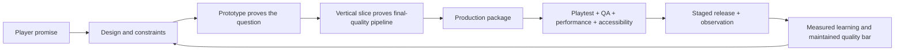

# AI game studio production standard

**Status, 11 October 2026:** this document defines how Living World’s autonomous studio must work if it is to meet the standard of a real game-development team. It is not a renderer plan and it is not a promise that a prototype with sprites and text is already a real game.

The studio is responsible for the same disciplines a strong game team would own: creative direction, systems, levels, story, art, technical art, animation, audio, UX, accessibility, engineering, networking, QA, release engineering, live operations, community safety and production management. AI may fulfill several disciplines in sequence, but every discipline needs its own artifacts, checks and definition of done.

## The production truth

A mechanic is not complete because its code compiles. A quest is not complete because text exists. A creature is not complete because a sprite draws. A client is not complete because it opens. A release is not complete because tests are green.

The correct unit of progress is a **player-validated, operationally supportable experience**:

A production vertical slice is a small part of the game that reaches the intended quality across disciplines. It answers “can this studio actually make the game?” rather than merely “does this isolated idea work?” [GDC: The Vertical Slice Challenge](https://media.gdcvault.com/gdc2015/presentations/Donovan_Greg_TheVerticalSlice.pdf)

## The studio lifecycle the AI must follow

| Stage | Question answered | Autonomous deliverables | Exit evidence |
| --- | --- | --- | --- |
| Discovery | What player promise or world problem is worth solving? | Evidence dossier, alternatives, impact/risk/cost/reversibility estimate, protected-identity assessment | A bounded hypothesis and a reason not to pursue the rejected alternatives. |
| Research and reference | What must be true for this to feel real, original and coherent? | Reference analysis, current bible updates, implementation constraints, rights/provenance plan, evaluation plan | Concrete target experience and measurable quality bar, not copied content. |
| Prototype | Should this mechanic or experience exist? | Disposable prototype, simulation or greybox scene; named question; short playthrough and outcome | It demonstrates or disproves the core interaction without claiming production quality. |
| Vertical slice | Can every discipline produce this experience at target quality? | Final-style scene/encounter/quest region; art, sound, UI, networking, persistence, accessibility, performance and test evidence | Representative end-to-end experience works in the World Lab and sets reusable production standards. |
| Production | Can the studio make enough coherent content/systems using that pipeline? | Versioned content packages, reusable tools, automated import/validation, task graph, asset/content manifests | Throughput, quality and compatibility stay within the established vertical-slice bar. |
| Alpha | Is the whole intended product playable end to end? | Complete critical path, major systems integrated, save migration, content coverage, defect/risk register | Feature completeness against declared scope; focus shifts from invention to quality. |
| Beta | Is the product stable, balanced, accessible and operable under real conditions? | Load/soak results, tuning reports, crash/defect trend, accessibility and security evidence, release/restore drills | Release criteria, support and operational readiness pass. |
| Live operation | Does the game improve without degrading its identity or player trust? | Health/experience/cost reports, content cadence, incident/postmortem records, experiment outcomes, regression corpus | Changes remain evidence-led, reversible and within the constitutional policy. |

The AI must label work honestly. A prototype cannot be promoted by calling it “vertical slice”; a candidate that was not played cannot be called “tested”; a story draft cannot be called “living World Intelligence.”

## The feature contract: one standard for every new thing

Before work starts, the studio must create a machine-readable **feature contract**. It applies equally to a new Guard mechanic, creature, class, quest, lighting effect, map region, audio cue, UI screen, economy rule, service or AI behaviour.

| Contract field | Required standard |
| --- | --- |
| Player promise | The specific experience: what the player notices, decides, feels, learns or gains. |
| Design role | Core loop, supporting loop, expression, accessibility, story, world health, operation or technical capability. |
| System contract | Inputs, authoritative state, outputs, invariants, error states, persistence, compatibility and removal/retirement plan. |
| Content contract | Art/audio/text/animation/scene requirements, source/provenance, stable IDs, fallbacks and localization/accessibility needs. |
| Interaction contract | Controls, feedback, timing, failure/retry, alternatives, consent and player-visible explanation. |
| Online contract | Client intent, Realm validation, message/versioning, rate limits, reconnect and multi-player interaction. |
| Quality bar | Target scenes, performance budget, visual/audio/UI standards, accessibility checks and test-player expectations. |
| Evaluation plan | Simulation, functional tests, playtest routes, screenshots/recordings, telemetry and success/failure thresholds. |
| Release plan | Migration, fixture coverage, feature flag/canary if needed, rollback and observation window. |
| Learning plan | Hypothesis, baseline, possible confounders, decision rule and future regression fixture. |

No ordinary feature needs an owner approval after it meets this contract inside the active release band. The AI owns the brief, implementation, evidence and result.

## Discipline standards

### 1. Game and systems design

The systems designer must produce more than ideas. For every core mechanic it owns:

1. A player goal, decision, cost, feedback loop and counterplay.
2. A state model and authoritative rules, including malformed/repeated/concurrent actions.
3. A balance model: variables, ranges, dependencies, dominant-strategy risks and sensitivity simulations.
4. At least three intent-player routes: novice, competent explorer and mastery/exploit seeker.
5. Failure/recovery paths, accessibility accommodations and clear player explanation.
6. Instrumentation that measures the hypothesis without turning engagement pressure into the objective.
7. Versioned tuning values and a rollback/migration plan.

For Living World, mechanics must reinforce discovery, player agency, turn-command clarity and historical consequence. An “optimal grind loop,” hidden mandatory build or permanently dominant rare power fails the design bar even if it raises a local activity metric.

### 2. World, level and encounter design

Each playable place needs a spatial and experiential contract:

- readable landmark, route, entrance/exit, rhythm, safe/recovery point and intended discovery;
- map topology, collision, traversal, camera, accessibility path and stuck-player recovery;
- population, ecology, resources, interactions, encounter locations and state changes;
- narrative purpose, history links, local mysteries and consequence surface;
- visual/audio atmosphere, lighting/fidelity tiers and performance budget;
- playtest route covering first arrival, return visit, refusal, death/retreat, reconnect and another player’s change;
- automated reachability/collision checks plus captured real scenes.

The AI must build and use greybox maps first, then prove that art, layout, encounters, story and performance work together. A beautiful inaccessible scene is not a finished location.

### 3. Narrative and quest design

The narrative director needs an explicit causal model rather than a generator that produces clever text:

- canonical fact graph and NPC beliefs kept separate;
- commitment ledger with promises, prerequisites, expiry, alternatives, consent and resolution;
- dialogue grounded in allowed facts and current player/world context;
- quest state machine with refusal, delay, loss, death, concurrent-player and reconnect paths;
- local tone/voice guide, mystery/reveal pacing and original-world checks;
- scenario suite that tries contradictions, soft locks, unwanted coercion and repetitive quest patterns;
- player-facing journal/history updates that explain consequence without exposing hidden system truth.

The World Intelligence begins in shadow mode. It must prove evidence use, abstention and continuity before it may create even a bounded live consequence.

### 4. Art direction, technical art and animation

The autonomous art studio must maintain a real production pipeline:

| Stage | Required output |
| --- | --- |
| Art brief | Player purpose, entity/scene role, style-bible references, required emotions, readability, animation and platform constraints. |
| Exploration | Several original silhouettes/compositions/palette directions, diversity notes and selection rationale. |
| Production asset | Source/derivative files, provenance/license, stable ID, dimensions, layers, animation timings, import settings and target variants. |
| Technical validation | Transparency/palette/frame/tile/seam checks, collision alignment, memory/download budget and malicious/executable-data rejection. |
| Scene validation | Actual in-game captures across representative environments, distance, UI overlap, motion, quality tier and accessibility settings. |
| Portfolio evaluation | Coherence with existing world, novelty, visual hierarchy, player legibility, performance and rollbackable release manifest. |

Art can evolve. The AI may alter palette, lighting, sprite form, shaders, 2.5D depth, animation and UI language, but it must show comparison captures and preserve stable player/world identities unless a compatible migration exists. “Generated a sprite” never counts as visual improvement by itself.

### 5. Audio and music

Audio has the same definition of done as visual work: intent, original/provenanced source, mix/loop points, game-state triggers, volume groups, captions/visual alternatives, device/browser fallback, performance/latency test and in-scene audition. The AI must not ship a raw generated track without rights, a loop contract and player controls.

### 6. UX and accessibility

Every interaction needs first-use guidance, contextual feedback, error recovery, keyboard/touch/controller paths, scalable text, contrast/color alternatives, remapping, motion/flash controls, readable saves and accessible alternatives for time/precision/audio requirements. The [Game Accessibility Guidelines](https://gameaccessibilityguidelines.com/full-list/) are the baseline reference; accessibility is a design input, not a late visual patch.

### 7. Client, engine and performance engineering

The client/engine team owns:

- deterministic render/input/network boundaries and a versioned Realm protocol;
- browser compatibility plus native quality tiers, device capability detection and graceful fallback;
- build/import/export scripts that run headlessly, with pinned engine and dependency versions;
- profiling on target builds/devices, not only in the editor; Unity’s profiling guidance makes this exact distinction, and the same rule applies to Godot. [Unity profiling guidance](https://docs.unity3d.com/2022.2/Documentation/Manual/profiler-profiling-applications.html)
- asset streaming/memory/frame-time/download budgets and regression thresholds;
- crash/error reporting, visual/input/network traces and privacy-aware diagnostics;
- client update/compatibility/rollback behavior.

The engine is an implementation choice. A Godot, Unity, custom, browser or future renderer upgrade must preserve the feature contract and test against the same playable fixtures.

### 8. Authoritative online engineering

The Realm team owns validated intents, state transitions, event receipts, deterministic replay, persistence, migrations, player isolation, anti-cheat, rate limits, reconnect, load degradation, backups and restore. Client code has no authority to award an item, choose a combat result, establish identity or mutate world facts.

### 9. QA, playtesting and compatibility

One testing method is never enough. The QA studio runs:

- rule/property/model tests for invariants;
- migration, restore, replay, load/soak and failure-injection tests;
- browser/native contract playthroughs for known player journeys;
- exploratory players for collision, soft locks, strange combinations and visual defects;
- intent players for clarity, combat choice, discovery, difficulty, story agency and accessibility;
- screenshot/recording comparison under pinned environments;
- adversarial player/model input and authorization checks;
- long-history fixtures so a new feature cannot quietly break old lives.

All defects become a reproducible case, severity/risk record, owner function, fix evidence and regression fixture. “Could not reproduce” is a finding that needs better instrumentation, not a reason to erase the report.

### 10. Production, release and live operation

The autonomous producer keeps the studio moving without a human project manager: dependency graph, scoped work, quality/cost/reversibility estimates, risk register, milestone evidence and honest status. The release/operator functions own immutable artifacts, independent validation, canaries, health thresholds, rollback, backup/restore, capacity, incident response and postmortems.

Operational change follows the same rigor as game content. An agent that detects a production problem follows a bounded runbook, records its action and verifies recovery. It does not improvise access expansion or edit production state outside policy. Service-level objectives, incident practice and controlled change management are mature SRE baselines. [Google SRE workbook](https://sre.google/workbook/table-of-contents/)

## The self-improvement loop that is real

Self-improvement does not mean the AI constantly makes changes or trains its own model. It means the studio reliably learns from durable evidence:

1. **Observe:** read world/player/technical facts with source and uncertainty.
2. **Diagnose:** distinguish defect, opportunity, hypothesis, risk and unknown.
3. **Design alternatives:** generate several possible interventions and reject ones that violate constraints or lack evaluation feasibility.
4. **Prototype:** answer the smallest high-value unknown cheaply in a disposable environment.
5. **Produce:** use the established pipeline only after a prototype/vertical slice warrants it.
6. **Evaluate:** compare fixed baselines, simulations, intent-player evidence, experience captures, performance, accessibility, cost and safety.
7. **Release safely:** promote only the exact validated artifact through the active policy band.
8. **Observe again:** compare predeclared expected and actual outcomes; watch for regressions and delayed effects.
9. **Retain a lesson:** store the evidence, confidence, decision and regression case; update a bible, tool, test, heuristic or backlog priority only when justified.

Trace inspection is useful during debugging, but real comparison needs durable datasets and repeated evaluation runs. [OpenAI agent workflow evaluation](https://developers.openai.com/api/docs/guides/agent-evals) A self-improving studio should also evaluate its whole workflow—not just one model response—because bad routing, tool selection or a skipped review can invalidate a plausible result. [OpenAI macro agent evals](https://developers.openai.com/cookbook/examples/partners/macro_evals_for_agentic_systems/macro_evals_for_agentic_systems)

## Anti-fake-game standards

The following are prohibited shortcuts, even if an agent can produce them quickly:

| Shortcut | Why it fails | Required replacement |
| --- | --- | --- |
| Text-only “quest” with no world consequence | It is exposition, not gameplay or a living world | State, player choice, world/NPC consequence, presentation, test route and recovery behavior. |
| Sprite placed without gameplay/scene validation | It may be unreadable, generic, broken or disconnected from the world | Art brief, asset provenance, interaction binding, in-scene capture, performance/accessibility evidence. |
| Mechanic with one happy-path test | It creates exploits, soft locks or empty choices | State model, adversarial/replay/intent tests, balance study, telemetry and rollback. |
| “AI-generated” status without evaluation | It rewards activity and hallucinated progress | Exact artifact, evidence report, release/observation result and honest limitation. |
| Endless polishing of one visual/objective | It creates repetition and hides missing systems | Portfolio diversity, opportunity cost and capability-atlas coverage. |
| Big rewrite to solve a vague feeling | It risks identity/history without proving value | Small prototype, vertical slice, protected impact report and staged migration. |
| Metrics optimized as the game’s purpose | It drives grind, dark patterns and genre drift | Player agency, discovery, coherence, accessibility, quality and world-health scorecard. |

## Current standard and the next proof

Living World currently has a real but small authoritative RPG foundation, an isolated Codex developer, durable records, a narrow visual-data release path and a first Godot fixture shell. It does **not** yet meet this production standard: there is no candidate World Lab, no end-to-end vertical slice at target quality, no full asset/audio pipeline, no protocol-parity Godot client, no model-led World Intelligence, no general source promotion and no unattended live operator.

The next proof must be one **vertical World Lab slice**, not another disconnected feature. A good candidate is a short original exploration-to-encounter sequence where the AI:

1. identifies a measurable combat or discovery problem;
2. prototypes and selects a solution;
3. produces a final-style map patch, creature, telegraph, encounter command feedback, sound/visual treatment and journal consequence;
4. runs it against preserved player history in the candidate Realm;
5. plays it through browser and Godot fixture clients, capturing experience/performance/accessibility evidence;
6. records a release-ready artifact, rollback plan and measured outcome—while keeping it staged until the independent promotion lane exists.

That one slice makes the AI prove it can operate like a real studio across design, engineering, art, QA and production, before it scales content or authority.
