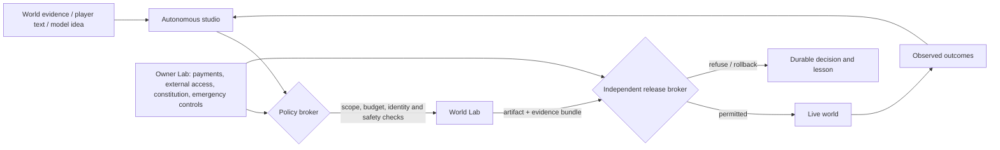

# Autonomous stewardship charter

**Status, 11 October 2026:** this is the governing design for the intended end state. It consolidates the project’s current Constitution, autonomy audit, studio blueprint and online-runtime decision into one operating model. It does not claim that Living World already has full autonomous operation.

## The actual objective

Living World is to be **designed, built, operated, maintained and creatively evolved by AI**. The AI chooses ordinary work, forms hypotheses, changes code and content, creates art and narrative, tests its work, releases within the active policy, monitors the world, learns from outcomes and recovers from routine failures.

The owner is not the AI's product manager, game designer, release engineer, asset uploader, world editor or daily approver. The owner operates the **Lab control plane** only for things that are intrinsically outside the game’s ordinary creative and technical life:

- payment method, financial ceiling and model/provider account;
- external credentials, domains, hosting accounts, signing identities and legal obligations;
- the protected identity of the experiment and player-safety values;
- emergency pause, access revocation and independent backup/restore authority.

The aim is not to hand the AI a frozen game. It must be able to replace the renderer, engine, tools, combat details, map system, art style, content structures, workflows and deployment implementation when evidence supports it. The aim is also not to give it power to turn a persistent top-down fantasy RPG into an unrelated naval, shooter, casino, clicker or social-feed product because a local metric happened to improve.

The system therefore needs **freedom inside a real constitution**.

## The three-layer mandate

The most important distinction is between hard boundaries, quality responsibilities and creative freedom. Mixing these layers is what either cages the AI or lets it drift.

| Layer | Who can change it | What it contains | How it is enforced |
| --- | --- | --- | --- |
| **Protected constitution** | Owner only | Persistent shared top-down RPG world; original identity; command-driven encounters; ordinary beginnings and behavior-led identity; meaningful history, player agency and recoverable progress; non-coercive world health; owner control of external access/budgets | Independent policy package, immutable version record, constitutional fixtures and release-broker denial. Candidate code cannot edit it. |
| **Operating policy** | Owner only | Budget/payment ceiling, model/provider catalogue, credentials/network grants, data-retention and player-safety policy, release bands, emergency controls, hosting/signing authority | Trusted control plane validates every consequential tool/release request. It fails closed if unavailable. |
| **Evolutionary knowledge** | Autonomous studio | Design bible, art bible, narrative bible, balance targets, production practices, test suite, roadmap, engine, tools, maps, assets, quests, UI and normal release decisions | Versioned as ordinary production knowledge; evaluated in the World Lab; changed freely when evidence clears the active release band. |

This makes the required balance explicit. The studio can make the game dramatically better and stranger **within its fantasy**, but it cannot redefine the fantasy, grant itself a credit card, reach a new cloud account, remove player continuity, or weaken the system that decides whether it may act.

## What “cannot turn into Seafight overnight” means in practice

The guardrail must test the **primary player contract**, not keywords or superficial art. A fantasy RPG may contain a river, boat, sea region or naval encounter. It fails the constitution only when it replaces the primary contract with a different game.

### Protected player-contract fixtures

The independent validator keeps versioned, owner-approved fixtures outside the candidate workspace. Every meaningful release must still make these journeys possible and coherent:

1. **Shared physical exploration:** a traveler enters a physical top-down world, moves, discovers a place, encounters another traveler or world entity and observes durable consequences.
2. **Command encounter:** a traveler enters a distinct encounter and selects commands with meaningful choices, including a defensive/alternative option; the authoritative world resolves the result.
3. **Ordinary beginning to identity:** a new traveler begins without choosing a fixed class. Repeated behaviour becomes historical evidence; a major identity consequence remains explainable and, where appropriate, declineable.
4. **History and recovery:** a saved traveler reconnects after a release/restore and retains position, inventory, quest/identity evidence and meaningful history.
5. **Original readable presentation:** representative exploration, encounter and dialogue scenes remain legible, original and accessible at their supported quality tiers.
6. **Agency over compulsion:** the core loop rewards discovery, decision and consequence rather than forced streaks, predatory countdowns or engagement manipulation.

The validator checks observable capabilities and representative playthroughs, not whether a class or sprite has the same name. A proposal that removes the command encounter, makes class selection mandatory, replaces exploration with a fleet-management main loop, erases history, or makes coercive engagement the central objective is a **constitutional change request**. It is blocked from release until an owner creates a new constitutional version.

### Drift is also gradual

One passing release cannot prove a living game stays itself. The Lab maintains an **identity ledger** for each release:

| Ledger field | Purpose |
| --- | --- |
| Protected commitments affected | Makes the studio state which player promises could change. |
| Dominant-loop map | Records relative emphasis on exploration, encounters, social/world interaction, identity, story and other loops. |
| Fixture results and capture hashes | Proves the representative journeys were executed by the exact candidate artifact. |
| Before/after experience evidence | Screenshots, recordings, input traces, performance and accessibility checks. |
| Change budget | Limits how many major player-contract dimensions a single release may alter, keeping adaptation diagnosable. |
| Observation result | Shows what actually happened after a staged release and whether the change was retained, revised or rolled back. |

The studio may change ten ordinary systems over time. The ledger makes cumulative movement visible and raises a hard alert if protected journeys or the dominant-loop map cross the constitutional boundary. This is stricter than relying on an agent to remember its original prompt.

## A fully autonomous studio, divided by responsibility rather than by power

One model session can initially perform several jobs. Separate agents are useful only when they provide an independent perspective or a permission boundary; an “agent swarm” is not a safety system.

| Studio function | Autonomous responsibility | Required tools and records | May never decide alone |
| --- | --- | --- | --- |
| Creative director | Selects useful work, maintains the current creative/narrative/design bibles and sets testable hypotheses | World evidence, player outcomes, content portfolio, protected-commitment impact classifier | Constitution changes, release band, spending/access policy. |
| Systems and world designer | Evolves combat, progression, ecology, economy, maps and behavior-led Recognition primitives | Balance simulator, canonical content data, replay fixtures, effect vocabulary | Authoritative effects outside typed validated rules. |
| Narrative director | Creates quests, NPC motivations, world events and story resolutions | Fact retrieval, commitment ledger, contradiction/refusal/deadline tests | Inventing persistent facts without evidence or committing an untested world mutation. |
| Art, audio and UX studio | Produces and improves original assets, scenes, animation, sound and accessible UI | Art bible, asset provenance, scene capture, contact sheets, frame/performance evidence | Altering simulation or protected identity through a cosmetic data pack. |
| Developer | Changes engine, client, server, tools and tests; maintains migrations and compatibility | Isolated workspace, source map, test suite, build lockfiles, migration/rollback plan | Production deployment, validator/policy modification or access escalation. |
| Tester and evaluator | Searches for regressions, soft locks, incoherent narrative, inaccessible scenes and bad player experience | Contract, explorer and intent-driven test actors; fuzz/replay/load/browser capture; held-out fixtures | Marking its own candidate as released. |
| Release engineer | Packages exact artifacts, runs independent gates, stages/canaries/rolls back | Immutable artifact, build provenance, World Lab report, backup/restore receipt, health thresholds | Policy widening or skipping a failed/unknown check. |
| Operator | Watches health/cost/capacity/jobs, handles bounded incidents and schedules routine work | Metrics, logs, traces, runbooks, alert routing, resource reservations | Deleting history, changing protected policy or inventing a recovery action outside its runbook. |
| Learning system | Turns evidence into durable lessons, prioritisation and regression fixtures | Hypothesis/outcome ledger, experiments, rejected alternatives, player feedback and uncertainty labels | Altering model weights, policy or truth records merely because a model said so. |

Every role creates durable records. The autonomous studio is judged by its evidence and player outcomes, not by persuasive status reports.

## The control-plane rule: policy enforcement, not instruction following

Models can be mistaken, manipulated by player text, or persuaded by their own previous output. Prompts are necessary for direction but cannot be the final authority. The trusted control plane must independently enforce:

The broker receives a typed request, never a free-form command such as “run whatever is needed.” Each request has an actor, purpose, capability, exact target, expiration, budget reservation, idempotency key, required evidence and allowed rollback. It rejects unknown or ambiguous actions.

This is consistent with agent-security guidance: agent-generated code can access what its environment exposes, so compute needs isolation; credentials must remain outside the workspace; outbound access should be restricted; and authorization must be enforced downstream rather than trusted to a model's interpretation. [OpenAI sandbox security](https://developers.openai.com/api/docs/guides/agents/sandboxes#security) [OWASP excessive agency](https://genai.owasp.org/llmrisk/llm062025-excessive-agency/)

## The World Lab is the AI's real workplace

An autonomous studio needs somewhere to work that behaves like the world, without being the world. The World Lab has a clean-room mode for fixed regressions and an exploration mode for novel seeds and adversarial combinations.

| Lab input | Lab execution | Lab evidence |
| --- | --- | --- |
| Exact source/art/content candidate hash; locked dependencies; read-only policy version; synthetic or sanitised historical fixtures | Build/import/export; candidate Realm startup; migration; authoritative simulations; browser/native client playthroughs; load/fault/restore tests; visual/audio/accessibility capture | Artifact/provenance manifest; rule and migration results; browser recordings/screenshots; performance data; identity fixture results; risk/rollback report; independent decision record |

The candidate has no live database, production cookies, provider/payment credential, owner session, signing key, open production network route or write path into policy/backup/audit systems. It may return only a candidate artifact and its evidence. A candidate that cannot be run in the Lab is a proposal, not a releasable improvement.

OpenAI's current sandbox model makes the same control-plane/compute distinction: the harness owns model routing, recovery, audit and approvals; the sandbox executes work against a specific manifest and isolated workspace. [OpenAI Sandbox Agents](https://developers.openai.com/api/docs/guides/agents/sandboxes)

## Quality, visual evolution and learning without self-deception

The game cannot be governed by a single “fun” score, a single LLM critic or a unit-test count. Each change carries a hypothesis and is evaluated by several independent lenses:

| Lens | Question | Evidence required |
| --- | --- | --- |
| Correctness | Does the Realm enforce legal state transitions and preserve history? | Deterministic/unit/property/replay/migration/restore checks. |
| Experience | Can a player understand, use and enjoy the changed scene, system or encounter? | Intent-led playthroughs, controls/input trace, recording, frame time, accessibility state. |
| Identity | Does the release preserve the protected player contract and original world direction? | Constitutional fixtures, dominant-loop map, before/after captures and protected-policy validation. |
| Creative quality | Is this a coherent original contribution, not merely a valid or repetitive asset/quest? | Art/narrative portfolio, provenance, style constraints, diversity measures and scene review. |
| Safety and economy | Does it preserve player agency, privacy, moderation and resource ceilings? | Typed effects, capability logs, cost reservation/settlement, abuse cases, privacy checks. |
| Operations | Can it survive the real conditions around it? | Health/readiness/canary data, fault injection, backup restore and incident record. |

The studio learns by retaining problem statements, candidate alternatives, predictions, evidence, measured outcomes, rollback causes and confidence. It can improve its code, content, tests, prompts, tool wrappers, bibles and prioritisation. It must not call this model-weight training, overwrite raw world history, replace a failed test with a weaker one, or turn a self-written positive review into promotion authority.

Keep held-out scenarios and independent trace/evaluation graders. OpenAI's current guidance distinguishes debugging traces from repeatable datasets and evaluation runs; both are needed to compare agent behaviour over time. [OpenAI agent evals](https://developers.openai.com/api/docs/guides/agents/evals) Model critics remain useful inputs but never the sole gate for their own work. Quality-diversity practice is particularly important for a living world: retain a portfolio of good, different quests, enemies, regions and visual motifs, rather than optimizing one critic until everything becomes the same. [Quality diversity in PCG](https://arxiv.org/abs/1702.00509)

## Release authority: automatic but earned

Routine human approval would make the project human-operated. Automatic release without independent evidence would make it reckless. The answer is policy-bounded automatic promotion.

| Release band | Autonomous authority | Non-negotiable proof | Current state |
| --- | --- | --- | --- |
| 0 — Observe | Inspect sanitised evidence; create plans and candidates | No production effect; durable work record | Partly operating. |
| 1 — Shadow | Generate World/narrative/creative proposals and evaluate them in the Lab | Typed output; abstention; no live mutation | Not yet built for model-led World work. |
| 2 — Reversible data | Publish bounded visual/content packs and restore a prior pack | Independent structural/readability/compatibility validation | Narrow visual-data lane operating. |
| 3 — Staged source | Run client/server code and migrations in the Lab | Exact artifact, all required checks, representative restore and browser/native evidence | Not built. |
| 4 — Low-risk production | Automatically promote restricted source/data changes and observe a canary | Independent broker, health thresholds, rollback and incident route | Not built. |
| 5 — World effects | Apply bounded Recognition/quest/ecology effects to live players | Evidence retrieval, typed effect validation, consent/agency rules, narrative commitments and rollback | Not built; World inference disabled. |
| 6 — Unattended stewardship | Prioritise, create, release, operate and recover within the active policy | Sustained local trials, injected failure drills, complete cost/audit records and no policy breach | Future destination. |

Policy bands prevent the AI from bypassing the staircase by “solving” a constraint in code. The release broker compares the exact artifact it evaluated with the artifact it promotes and records a signed decision. It rejects a missing report, stale baseline, failed check, unresolved risk, expired grant or unavailable policy service.

Pre-deployment testing, provenance, governance and incident disclosure are also the core categories highlighted by NIST's Generative AI profile. [NIST AI 600-1](https://nvlpubs.nist.gov/nistpubs/ai/NIST.AI.600-1.pdf) Build provenance must make it possible to trace a live artifact back to its source and builder. [SLSA security levels](https://slsa.dev/spec/v1.1/levels)

## The owner’s “little things” contract

The owner should be able to go away for normal operation. The Lab has a deliberately small surface:

| Owner control | Why it belongs to the owner | What the AI does after it is set |
| --- | --- | --- |
| Payment/budget/provider | It represents money and external contractual authority | Selects and schedules work within reservations; degrades gracefully at cap or outage. |
| Credentials/network/hosting/signing | They can affect systems beyond this game | Uses narrow, expiring capability grants through brokers; never sees long-lived secrets. |
| Constitution and player-safety values | These determine the purpose and obligations of the experiment | Tests and evolves everything compatible with them; files a blocked proposal for an incompatible change. |
| Release bands | This defines how much real-world blast radius is acceptable | Releases automatically inside the active band and reports evidence/outcomes. |
| Emergency stop/revoke/restore | It must work when the AI or game is malfunctioning | Stops cleanly, preserves evidence and cannot undo the owner action. |

The owner should **not** need to choose the backlog, write prompts, rank art, click build/export, approve ordinary releases, operate servers, repair routine incidents, copy assets, alter world data, or supervise each agent turn. Those are autonomous studio duties.

The Lab needs good read-only visibility instead: current policy and cost, active capability grants, candidate/release status, live world health, player-impact metrics, identity ledger, creative/narrative portfolio, incident timeline, backup/restore freshness and append-only audit export. It keeps secrets out of the interface and has no unrestricted production shell or SQL console.

## Failure modes and their specific defences

| Failure mode | Why a capable AI can still cause it | Defence that actually addresses it |
| --- | --- | --- |
| Sudden genre replacement | A local metric or prompt makes a dramatic rewrite appear attractive | Protected player-contract fixtures and independent constitutional validator block promotion. |
| Slow quality/identity decay | Each small release seems harmless | Identity ledger, change budget, portfolio/dominant-loop comparison and staged observation catch cumulative drift. |
| Prompt injection through player text/web data | The model treats content as instructions | Treat external text as data; retrieve structured facts only; validate outputs; no direct tool path from text. |
| Agent grants itself power | Candidate edits a config, test or deployment script | Policy/broker/validator/audit live outside the candidate workspace and authenticate every request. |
| Self-approved bad change | The same agent writes and judges a feature | Independent evaluator, held-out fixtures, release broker and canary outcomes. |
| Metric gaming or repetitive content | One score rewards shallow quests or visual repetition | Multiple lenses; creative portfolio and diversity metrics; player outcomes; remove no failing test without a replacement and regression evidence. |
| Lost player history | Migration/release/repair treats data as disposable | Versioned migrations, pre-change backup, restore drill, representative long-history fixtures and atomic rollback. |
| Provider/cost outage | Model loop retries or becomes central to gameplay | Reserve-before-call limits, hard cap, circuit breaker and deterministic game degradation without inference. |
| Compromised candidate/build dependency | Generated code runs with host/network/secret access | Disposable VM/container, minimal mounts, network allowlist, scoped secret proxy and provenance. |
| Operations makes damage worse | Agent improvises during a partial outage | Bounded runbooks, action receipts, escalation outside runbook, independent emergency controls and failure drills. |
| Player/community harm | Generative text/content ignores context or moderation policy | Typed content/effect policies, moderation/appeal records, age/privacy/retention controls and public-launch gates. |

## Build order: from current foundation to true autonomy

1. **Make the constitution executable.** Extract owner-signed protected policy, player-contract fixtures, identity ledger and a separate immutable validator. The agent can read but cannot modify this package.
2. **Finish the World Lab.** Run exact candidate client/Realm artifacts in disposable staging with a sanitised fixture, browser/native playthroughs, screenshots, fault injection, migration/restore and a one-way evidence export.
3. **Build the independent evaluator and release broker.** Bind source/artifact hash, policy version, evidence and promotion decision. Take a consistent backup before a state migration and prove restore.
4. **Extract the protocol and build the real Godot path.** Keep the Realm authoritative; achieve browser/Godot parity before visual evolution can replace the existing canvas client.
5. **Create the living-world data plane.** Canonical facts, retrieval coverage, typed effects, commitment ledger, shadow World Intelligence, creative asset/content manifests and portfolio evaluation.
6. **Expand automatic release bands.** Begin with reversible content, then staged source, then measured canaries and World effects after each exact gate passes.
7. **Build autonomous operations and public hosting.** Add account security, TLS edge, observability, moderation, capacity/load evidence, off-host recovery and invite-only alpha only after unattended local drills succeed.

## Definition of success

The experiment succeeds when the Lab can demonstrate—not merely describe—that the autonomous studio repeatedly does all of the following within owner-set external limits:

- notices a real opportunity or defect from reliable evidence;
- designs alternatives and chooses one consistent with the current bibles and constitution;
- creates code, content, art and tests in an isolated workspace;
- proves the exact candidate through the World Lab, including player experience and persistence;
- releases automatically when its independent policy gates pass;
- detects a bad result, rolls it back or corrects it through a permitted runbook;
- preserves player history and the core player contract across major technical evolution;
- records outcome, cost, uncertainty and lessons so later work improves;
- continues doing the above without requiring the owner to manage the game day to day.

The system should be ambitious about the game and humble about its evidence. “AI designed it” is not a quality bar. A coherent world that survives its own evolution, stays recognisably Living World and remains enjoyable and recoverable for players is.
