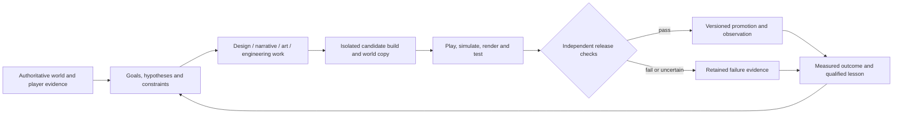

# Living World autonomous studio blueprint

**Status, 11 October 2026:** this is a researched build plan, not a description of a finished autonomous studio. Living World v0.5.0 already has a bounded Codex developer that chooses a focused task, changes an isolated source copy, runs offline checks, remembers the outcome and can publish a tightly validated visual-data pack. It does **not** yet run or play candidate builds in staging, deploy general code, generate live World Intelligence content, judge actual game scenes, or recover the live service unattended. The protected identity remains in [CONSTITUTION.md](CONSTITUTION.md).

This document answers one practical question: what must an AI have to do the work of a small game studio well enough to improve Living World over time without becoming a random-change machine?

The answer is not simply a more powerful model. It is a complete production loop: stable direction, useful tools, a safe place to make changes, ways to experience the result, independent checks, reversible release machinery, and memory that distinguishes evidence from a persuasive story about evidence.

## The studio as one coherent loop

The eventual steward can have specialised roles, but they share a single product direction and durable evidence store. Do not start by splitting this into an army of conversational agents. A simple composable workflow with explicit hand-offs is easier to evaluate, debug and improve; agent research makes the same point. [Building Effective AI Agents](https://www.anthropic.com/engineering/building-effective-agents)



Every arrow has to produce a durable artifact. A task without a hypothesis becomes busywork. A candidate without a playable staging environment is an unverified patch. A release without a recovery path is a gamble. A lesson without source evidence is only a claim.

The team roles below describe responsibilities, not permanent independent accounts. One bounded developer can initially execute several roles in sequence. Separate accounts, processes and permissions only where a hand-off protects the game: candidate execution, production promotion, owner access, credentials and constitutional enforcement.

## The roles, their tools and their definition of done

| Studio responsibility | What the agent needs | Deliverable | Evidence before it can call the work done |
| --- | --- | --- | --- |
| Creative director and producer | Constitution, art/narrative bibles, product pillars, current capability map, goals, cost/impact/reversibility estimates | A small prioritised goal with a hypothesis and explicit non-goals | It is compatible with the protected identity, has a measurable outcome, and does not outrank a service or history repair without reason |
| Systems and combat designer | Deterministic rules, balance tables, encounter logs, reproducible seeds, scenario runner, telemetry | Versioned mechanic/content specification and a candidate | Rule invariants, exploit scenarios, paired battle simulations, and an actual playable encounter. Mechanics must lead to intended player dynamics and feelings, not just legal state transitions; this is the useful direction of the [MDA framework](https://users.cs.northwestern.edu/~hunicke/MDA). |
| World, quest and narrative designer | Canon facts, temporal NPC beliefs, relationships, goals, locations, causal graph, player choices and world history | A typed story/quest proposal with causes, alternatives, endings and provenance | Every required precondition is true, NPC actions have an in-world intention, players retain meaningful choices, and the proposal does not contradict known history. Causal planning is a better backbone than unconstrained prose; [Riedl and Young](https://arxiv.org/abs/1401.3841) show why character intention matters alongside plot. |
| World Intelligence | Curated event retrieval, confidence/coverage metadata, typed effect vocabulary, proposal validator, cost and consent rules | Recognition, quest, relationship, ecology or content proposal | References exact evidence, declares uncertainty, passes server validation at commit time, uses an idempotency receipt and records consequences. It never turns free-form model text directly into a state mutation. |
| Level and environment designer | Map schema, tile/object semantics, collision/navigation analyser, templates, automapping rules, seeded generation and screenshot captures | Map/content bundle with landmarks, encounters, traversal and discovery beats | Reachability, collision, quest path, performance and visual legibility pass. A structured map format with typed properties and rules allows the agent to alter worlds deliberately rather than paint pixels blindly; [Tiled’s properties](https://doc.mapeditor.org/en/stable/manual/custom-properties/) and [automapping](https://doc.mapeditor.org/en/stable/manual/automapping/) are useful patterns. |
| Art director, concept artist and pixel artist | Versioned art bible; palette; silhouette, scale and animation rules; asset manifests; image references; raster editor/exporter; contact sheets and actual game captures | Original concept sheet plus sprites, tiles, UI, effects or portraits tied to stable entity IDs | Provenance, usage rights, dimensions, frame timings, tile seams, contrast, animation/motion settings and in-game screenshots are recorded. A visual release is not "better" merely because its JSON validates. |
| Audio designer | Sound bible, event-to-cue map, original/provenance-tagged assets, mixer, timing profiler and subtitle/caption hooks | Short effect/music bundle and mix rules | User-controlled category volumes, no required information conveyed only by sound, no autoplay assumption, and timing works in real browser play. Web audio must begin from user interaction and offer controls; see [MDN guidance](https://developer.mozilla.org/en-US/docs/Web/API/Web_Audio_API/Best_practices). |
| Gameplay/client engineer | Source, architecture map, deterministic contract tests, browser inspector, profiler, accessibility checks and live-candidate screenshots | Candidate implementation and migration/compatibility plan | Unit, integration, state-machine and browser interaction checks pass in staging; keyboard/touch/reduced-motion paths work; the author has shown the actual result, not just edited files. |
| Backend, persistence and multiplayer engineer | Versioned schemas, representative saved worlds, load/reconnect harness, replay fixtures, backup/restore drill and protocol contract tests | Server candidate, migration and rollback plan | The server remains authoritative; duplicate/reordered commands, disconnects, stale proposals and mixed versions are exercised; migration failure preserves the old world. |
| QA and test engineering | Scenario library, property/model tests, fuzzing, browser flows, screenshot/video capture, performance/load/soak tools and bug reproduction records | A versioned evaluation report, not merely a green test count | Protected rules, regression fixtures, fresh scenarios and actual browser flows all pass. Model-based command testing is especially suitable for persistent game state; [fast-check’s model testing](https://fast-check.dev/docs/advanced/model-based-testing/) describes the approach. |
| Player-research and accessibility steward | Clearly labelled player feedback, consent/privacy scope, replayable telemetry aggregates, accessibility matrix, test personas and calibration sessions | A finding with uncertainty and a follow-up experiment | The evidence distinguishes real players from simulated players and correlation from cause. Important controls remain remappable, readable and not colour-only; [Game Accessibility Guidelines](https://gameaccessibilityguidelines.com/basic/) gives a practical starting baseline. |
| Release engineer and operator | Immutable artifacts, isolated staging, release manifest, migration backup, health/readiness checks, logs/metrics/traces, restart and restore runbooks | Promoted release or an explicit rejection | Exact tested artifact is promoted, observations stay within thresholds, rollback works, and a drill proves player history survives. A release is a controlled experiment, not a copy command. |
| Learning steward | Goal/attempt/experiment/lesson records, evidence links, counter-evidence, evaluation versions, expiry and retrieval rules | A qualified lesson or an explicit inconclusive result | It says what was observed, in which versions/scenarios, what remains unknown, and what future task it applies to. It does not claim a model-weight update when it only saved external memory. |

## What the agent must be able to experience

An autonomous creator cannot improve what it cannot inspect. Living World should eventually give the candidate developer a task-scoped studio workstation with these inputs and instruments:

1. **A repository map.** Architecture, interfaces, current content IDs, migrations, command contracts, test locations, active releases and a change history. It must know which code is authoritative and which files are generated or protected.
2. **A world dossier with boundaries.** Aggregated signals plus retrievable authoritative event slices. Each result declares source IDs, time interval, completeness, privacy scope, truncation and conflicts. Player text, model claims and trusted rules stay in separate fields.
3. **A deterministic world copy.** Snapshot database, pinned code/content/assets, clock and random seeds. It includes both fresh players and representative long histories. The candidate can create disposable test travelers without touching live progress.
4. **A real browser game.** The agent needs to start the candidate service inside a sealed staging compartment, connect browser clients, execute an input script, inspect DOM/canvas screenshots, console errors, network messages and frame timing. A contact sheet is useful but cannot substitute for this.
5. **A scenario runner.** Reproducible scripts for first-session onboarding, exploration, encounter choices, completion, death/recovery, reconnect, simultaneous players, failure/abuse attempts and long-running world time. Each script records seed, inputs, build, content and world version.
6. **A design workbench.** Balance table visualisation, battle simulator, quest/causal graph viewer, map editor/validator, art contact sheets, sprite preview, UI layout capture, audio audition and content dependency graph.
7. **An operations console.** Health, queue lag, errors, latency, database health, disk/backups, deployment state and costs. Traces, metrics and logs need common IDs; [OpenTelemetry](https://opentelemetry.io/docs/concepts/signals/) calls these distinct but complementary signals.

The key missing instrument today is number four: candidate code is deliberately not run on the privileged localhost host. The next major architecture slice should give it a separate, disposable staging runtime with a copy of the world and browser access only to that runtime. It needs CPU/memory/time limits, no production credentials, blocked production/host network access, and one artifact-export channel. Current native MXC isolation is a meaningful candidate-editing boundary but not that complete integration/release compartment.

## Creative systems that keep freedom without chaos

### Design direction and controlled evolution

The constitution is intentionally narrow. It protects the shared top-down world, command-driven encounters, behavior-led identity, history and player agency. Everything else should be represented as changeable production knowledge:

- a **creative north star**: ordinary beginnings, discovery, consequence, readable classic-RPG encounter clarity, original identity and meaningful stories over engagement manipulation;
- a **design bible**: core loops, pacing, difficulty bands, resource economy, counterplay, player-facing rules and anti-patterns;
- an **art bible**: scale, palette roles, shape language, composition, terrain/material rules, UI language, animation timing, lighting/effects and accessibility constraints;
- a **narrative bible**: metaphysics, factions, unresolved mysteries, tone, taboos, chronology, terminology and rules for revealing knowledge;
- a **sound bible**: instrument families, ambience, combat cue hierarchy, silence, mix levels and subtitle strategy.

These are versioned source artifacts, not eternal prompts. The agent may propose revisions, compare variants and migrate the world’s expression while the constitution prevents it from changing the game’s fundamental promise. Existing characters, player artifacts and historical events need migration/continuity plans when visual or narrative direction evolves.

### Visual and asset production

The first live art lane is deliberately small: validated palette and 16x16 pixel data. A full art capability grows in layers:

1. Asset manifest: stable entity ID, kind, source files, output files, dimensions, colour mode, animation tags, usage rights/origin, generator/model/settings where relevant, dependent builds and release ID.
2. Art bible validator: palette roles, silhouette coverage, transparency, contrast, tile edges, frames, reduced motion and asset budgets. It blocks broken assets, not a stylistic direction it cannot understand.
3. Original asset creation: pixel-native drawings first; optional image generation only through a separate adapter and budget. Generated image output is an input to a cleanup/export workflow, never an unreviewed sprite sheet. Image generation can struggle with recurring-character consistency, exact text and precise layout, so it needs controlled references and downstream validation. [OpenAI’s image guidance](https://developers.openai.com/api/docs/guides/image-generation) states these limitations directly.
4. Raster export: source layers/tags become fixed sprite sheets and JSON metadata. Tools such as [Aseprite’s CLI](https://aseprite.org/docs/cli/) show the useful contract: sheet plus metadata, animation tags and explicit dimensions.
5. Actual-scene evaluation: fixed desktop/mobile scenes before/after, contrast and motion checks, frame time, text readability, sprite recognition at gameplay scale and player feedback.
6. Reversible asset promotion: immutable pack, active-version pointer, automatic fallback, and art outcomes linked to the actual scene captures that informed the next choice.

For audio, use an equivalent manifest and cue map. Start with small original effects and environmental layers; add generated music only after there is a clear provenance, licensing, looping, performance and user-control contract. Do not let an audio generator silently write directly into the shipped bundle.

### Narrative, NPCs and living-world logic

A story model has to represent more than dialogue. The minimum durable records are:

- **facts**: authoritative world state and event history;
- **beliefs**: what each NPC/player knows or wrongly believes, with source, confidence and validity time;
- **relationships**: affinity, debt, fear, trust, promises, conflicts and history;
- **intentions and plans**: goal, preconditions, feasible actions, reasons and fallback;
- **threads**: unanswered questions, active hooks, causal dependencies, player choices, stakes and outcomes;
- **canon candidates**: lore that is proposed, accepted, superseded or deliberately left unknown.

The model can interpret meaningful event clusters and draft language, but the server owns ordinary NPC schedules, movement, inventories and valid actions. Generative Agents is a useful pattern for observation, reflection and planning, not proof that open-ended NPC life is production-ready. Its study found each of those components mattered in its small-town simulation. [Generative Agents](https://arxiv.org/abs/2304.03442)

Quest generation must be a constrained causal graph: who wants what, why they cannot have it, prerequisites, possible routes, costs, irreversible consequences, decline/refusal outcome, and completion/abandonment states. Dialogue then presents that structure in character voice. This avoids the familiar failure where an LLM writes a beautiful request for an object that cannot exist or forgets that the player already used it.

Recognition should be the strongest form of this pipeline. It needs repeated behavior, a novelty/lineage comparison, competing interpretations, player agency/consent when identity changes matter, server-defined effects/costs, and a record explaining why the World recognized the path. It should first run in shadow mode, producing proposals and retrospective evaluations before it can change a live identity.

## Engineering and quality: how it proves a change is real

The autonomous studio needs four different kinds of checks. None can replace the others.

| Check | Example | What it proves | What it cannot prove alone |
| --- | --- | --- | --- |
| Rule/property check | One reward per receipt; Guard never increases damage; map exits are reachable | Authoritative mechanics and invariants | That players understand or enjoy it |
| World-copy simulation | Cautious, explorer and exploit bots run the same seeded quest/battle | Balance, soft locks, economy/exploit pressure and regression across variants | Real-player emotion or novelty |
| Browser/playtest capture | Script reaches a combat decision on desktop and touch layout; screenshots/frame trace | The player can actually see and operate the feature | Long-term retention or narrative meaning |
| Outcome study | Before/after cohort or carefully scoped world observation | Whether the proposed benefit appeared in use | Strong causality without controls and enough data |

For generated content, test the generator, not a hand-picked highlight. Content-generator research recommends looking at its expressive range and player impact: sample many outputs, measure the dimensions that matter, then use player studies for claims about experience. [Evaluating Content Generators](https://www.pcgbook.com/chapter12.pdf) explains the difference. For maps, those dimensions might be route length, encounter density, safe-rest distance, discovery variety and reachable exits. For skills, they might be counterplay, cost, rarity, damage distribution and interaction diversity. For quests, they might be branch count, causal depth, repeated premise rate and completion/abandonment paths.

Screenshot checks are useful regression evidence, not an art critic. Pin the browser/environment, compare named scenes and retain the expected/actual/diff. [Playwright](https://playwright.dev/docs/test-snapshots) warns that screenshots vary by browser, platform and rendering conditions. A model critic can score paired images against a detailed rubric after it is calibrated against human judgements; it must not become the sole judge of its own work. Model judges have position and verbosity biases. [MT-Bench research](https://arxiv.org/abs/2306.05685) and [OpenAI evaluation guidance](https://developers.openai.com/api/docs/guides/evaluation-best-practices) both support pairwise/rubric-based evaluation and explicit calibration.

The evaluation suite itself is production data. Keep protected constitutional and release checks outside the candidate’s write boundary. Let the developer improve ordinary quality tests, but version the change and retest against withheld scenarios. A green suite after deleting the test that caught the regression is not progress.

## Learning without pretending to train a new brain

The learning engine should improve decisions through durable external memory and evaluation. It does not require model fine-tuning to become useful.

Each attempt records:

```text
goal → hypothesis → baseline + candidate → versions + seed → scenarios
→ measures + guardrails → observations + cost → decision → lesson / uncertainty
```

A reusable lesson includes the evidence IDs, relevant game/version conditions, supporting and contrary outcomes, confidence, expiry/recheck condition and the next test. A “skill” is a versioned procedure with explicitly permitted tools, prerequisites and tests, not an arbitrary script that received authority because a model described it.

This mirrors the valuable parts of lifelong-agent work: an automatic curriculum, reusable skill library, feedback and self-verification in [Voyager](https://arxiv.org/abs/2305.16291), plus between-attempt verbal feedback in [Reflexion](https://arxiv.org/abs/2303.11366). It does not justify magical claims of permanent self-improvement. It will sometimes choose the wrong task, misread sparse telemetry or overfit its own checks. A realistic long task also cannot be delegated simply because a model performed on a short benchmark; reliability-critical work needs far higher confidence than a 50% completion threshold. [METR’s limitation note](https://metr.org/notes/2026-01-22-time-horizon-limitations/)

Task choice should score, at minimum: player/world impact, evidence strength, urgency, reversibility, blast radius, evaluation feasibility, cost, novelty and conflict with current work. A service/data recovery wins over cosmetic variation. Thin evidence causes a small observation experiment, not a sweeping overhaul. Repeated failed approaches must retrieve prior failure evidence and state what is materially different this time.

## Release and operation: freedom with a real safety boundary

The general-code promotion lane must be a separate production system, not a permission flag in the developer copy.

1. Candidate produces source/content/assets and a machine-readable release intent: source hash, world/schema/content/asset versions, migration, expected benefit, test evidence, health thresholds, observation window and rollback plan.
2. A protected builder constructs a single immutable artifact from that exact source hash. It runs the fixed independent check suite and creates a world-copy staging deployment.
3. A staging player/simulator drives the candidate through key scenarios. The release validator compares artifacts, database migration result, browser outputs, health and performance against acceptance gates.
4. Promotion takes a fresh consistent backup, drains or gates the single writer if necessary, verifies compatibility, activates the artifact and monitors the defined window. In a single shared-world service, start with controlled drain/restart and feature flags; do not pretend arbitrary two-instance canaries share a safe SQLite writer.
5. If health/recovery criteria fail, restore the compatible version or use a planned forward repair. Preserve all acknowledged progress and record the incident. The agent gets the result as evidence for the next decision.

Small, immutable releases make this much easier to diagnose and recover. [Google’s canary guidance](https://sre.google/workbook/canarying-releases/) frames a canary as a limited, time-bound deployment with an explicit decision. SQLite’s online backup creates a snapshot while the database remains available, which supports the required pre-migration backup path. [SQLite Backup API](https://sqlite.org/backup.html)

For hostile or merely mistaken candidate code, language-level permissions are insufficient as the only containment. Node explicitly describes its permission model as a seat belt rather than a security guarantee against malicious code. [Node permissions](https://nodejs.org/download/release/v26.7.0/docs/api/permissions.html) The staging compartment therefore needs OS/process isolation and scoped filesystem/network access. Windows Sandbox can provide a disposable VM with networking disabled and narrowly mapped folders, but mapped host folders remain an exposure to design carefully. [Microsoft Windows Sandbox](https://learn.microsoft.com/en-us/windows/security/application-security/application-isolation/windows-sandbox/windows-sandbox-configure-using-wsb-file)

## Capability ladder: the order that makes the experiment credible

| Phase | Build | Concrete proof before expanding authority |
| --- | --- | --- |
| 0 — Current seed | Isolated Codex source proposals, outcome ledger, validated visual-data lane, live game/history/backup foundation | Already demonstrated: two autonomous candidates completed isolated checks; no general source release or live World Intelligence claim |
| 1 — Studio records | Goals, experiments, evidence coverage, scenario/version registry, art/narrative bibles, content/asset manifests, evaluation dashboard | A goal is selected from evidence, an inconclusive result is retained, and a later task avoids a documented failed approach |
| 2 — Candidate staging | Disposable service + world copy + browser driver + browser captures + integration/load/reconnect tests | The agent changes a combat/UI feature, starts only the candidate, plays it through a browser scenario and attaches real captures/performance evidence without reaching live data or credentials |
| 3 — Content and creative workbench | Typed quests/effects, NPC belief/intent graph, map/asset/audio pipelines, quality/expressive-range evaluation | It adds one original world element end-to-end: story cause, map placement, visual/audio presentation, test scenario and rollbackable bundle |
| 4 — Shadow World Intelligence | Metered durable provider broker, structured proposals, retrieval coverage, model/semantic evaluations and human-calibrated critics | It produces duplicate-safe Recognition/quest proposals, correctly abstains on missing evidence and predicts an outcome on withheld scenarios; no live application yet |
| 5 — Protected source release | Immutable build/promotion service, independent validator, migration/restore drills, feature flags, monitoring and automatic rollback rules | A deliberately broken candidate is blocked; a deliberately bad release is detected and recovered without erasing committed player history |
| 6 — Bounded autonomous operation | Operator runbooks, health/incident tasks, reliable scheduling, spend settlement, production observation and recovery policies | Sustained unattended local operation completes useful work, handles injected failures, respects limits and produces auditable outcomes over repeated trials |
| 7 — Hosted alpha | Account auth, HTTPS/proxy policy, supervision, off-host backups, capacity/load test, production staging equivalence and invite-only feedback | A clean-host restore/deploy works, capacity is declared and measured, and actual player evidence recalibrates simulations and critics |

The immediate next slice is phase 2, not more model power. It converts the two retained source proposals into something the studio can inspect in a sealed world copy. Once the agent can create, run, play, capture and reject its own candidate safely, the art, story, balance and learning systems have a place to prove themselves.

## First end-to-end demonstration to aim for

Use the newly retained "telegraphed creature attacks" proposal as the first rehearsal, without touching live players:

1. Build its exact candidate hash into the staging compartment with a copied world.
2. Run deterministic combat checks and a browser script that enters the encounter, reads the telegraph, Guards a heavy turn, heals, retreats and reconnects.
3. Capture desktop/mobile scenes, command logs, world events and frame/latency data. Compare against the prior baseline using paired seeded encounters.
4. Have a calibrated critic score only the stated visual/clarity criteria, while structural checks decide correctness.
5. Store the result: whether the telegraph is visible, whether Guard changes simulated decision quality, whether any protected behavior changed, and what player evidence is still missing.
6. If release machinery is not built, retain it as a staging-validated candidate. When it is built, promote only through the protected production lane and observe real outcomes against predeclared guardrails.

That single slice exercises combat design, interface clarity, engineering, QA, browser playtesting, release evidence and learning. It is much more valuable than connecting a model to every future system at once.

## Owner controls that remain non-negotiable

The autonomous studio may redesign ordinary gameplay, visuals, systems and workflows. The following remain external to its authority: protected product commitments; model/provider choices and cost ceilings; credential and network grants; production release policy; emergency stop; and access to private data. Player text, imported web material, model output and candidate code are data, never new instructions or permission grants. Structured outputs and validation make these boundaries enforceable instead of aspirational. [OpenAI agent safety guidance](https://developers.openai.com/api/docs/guides/agent-builder-safety) and [Structured Outputs](https://developers.openai.com/api/docs/guides/structured-outputs) explain the relevant pattern.

This is what makes the experiment both free and meaningful: the developer may replace a starter renderer or rebuild combat, but it cannot rewrite the lock that decides whether its candidate gets production credentials or becomes the live game.

## Honest current assessment

Living World has a serious foundation for a studio experiment: authoritative state, history/provenance, durable jobs, owner dashboard, backups, a separate Codex account path, isolated source copies, candidate checks, outcome memory and a constrained reversible art-release lane. It has now produced two autonomous source proposals, including a combat-readability proposal, from its own observed evidence.

It is not yet a full autonomous game company. The current agent cannot independently play a candidate in a real staging world, measure real visual quality, create full original asset bundles, manage a causally consistent generated story, run model-driven Recognition, ship source code, or repair a failed production deploy. Those are the capabilities this blueprint orders and makes testable.

The goal is not to claim perfection on day one. It is to give the agent every tool a small studio uses, then require each tool to earn its authority through observable work, recovered failures and better next decisions.

## Deep research update: what changes after examining the hard cases

This section records a second research pass on 11 October 2026. It changes the implementation emphasis in four useful ways.

### 1. The candidate world is an evaluation product, not merely a safe server

OpenAI's current sandbox architecture separates a trusted control plane from the execution workspace, uses a manifest as the fresh-workspace contract, supports snapshots/resumption, and can expose a sandbox port for an inspectable preview. [Sandbox Agents](https://developers.openai.com/api/docs/guides/agents/sandboxes) This matches Living World's next need precisely.

The staging compartment should therefore be built as a first-class **World Lab** with a fixed contract:

| World Lab input | Why it is required | Must not contain |
| --- | --- | --- |
| Candidate source hash and locked dependencies | The artifact being played must be exactly the artifact being evaluated | A write path into live source or release policy |
| Fresh snapshot plus named historical fixtures | A feature can work for a new traveler and break a long-running quest/history | Live database, owner session, provider credentials or browser cookies |
| Scenario seed, virtual clock and test identities | A failure must be reproducible and comparable across variants | A hidden dependency on live traffic or wall-clock luck |
| Restricted service port and browser-driver channel | The agent must see the running game and operate it as a player | Host/production loopback reachability |
| Artifact-only export directory | Screenshots, traces, report, world diff and candidate bundle are reviewable afterwards | An arbitrary mount of the repository or data directory |

The lab needs two modes. **Clean-room mode** starts from a known fixture and is the authority for regressions. **Exploration mode** generates disposable worlds/identities/seeds to seek soft locks, odd combinations and visual/collision errors. Neither replaces real play; together they prevent the agent from treating one lucky demonstration as a release proof.

### 2. A game tester needs three kinds of player, not one generic simulator

Production game-testing research found that reinforcement-learning testing had to be integrated into established scripted-bot workflows, in part because development and final environments differ. [Gillberg et al.](https://arxiv.org/abs/2307.11105) A separate pixel-driven testing system used three complementary behaviors: space exploration, key-object detection and human-like investigation. It found collision defects that are easy to miss with ordinary scripts. [Inspector](https://arxiv.org/abs/2207.08379)

Living World's test roster should use the same division of labour:

- **Contract players** execute short explicit scenarios: new-game tutorial, movement/collision, first quest, every command, defeat/recovery, reconnect, duplicate delivery, two concurrent travelers and migration fixture. They prove known commitments.
- **Explorer players** maximize unseen maps, object states, command combinations, quest branches and event signatures. They search for unknown failure modes and record the shortest replay.
- **Intent players** behave like named styles: cautious survivor, curious explorer, resource hoarder, aggressive fighter, social helper and exploit seeker. They make balance and agency studies more useful than a uniform random walker.

For an early 2D RPG, the first two can be deterministic graph/search tooling plus browser scenarios; reinforcement learning is optional and should be introduced only when measured coverage requires it. The important artifact is a **coverage map**: visited tiles, objects inspected, state/branch coverage, command combinations, events emitted, quest states reached and unique failures. A high completion count without this map is not evidence of broad testing.

### 3. Narrative has to be a verified commitment system

Recent interactive-narrative benchmarking reports a severe gap between fluent prose and durable consistency: its strongest evaluated model survived only 42% of 20-turn commitment tests, with fact-conflict rates of 40–68%. [NCP-Bench](https://arxiv.org/abs/2608.08160) The exact figures are from a recent benchmark and should not be treated as a universal model ranking; the architectural finding is stronger: narration must never be the world database.

The World Intelligence design should become a four-step protocol:

```text
retrieve canonical facts + relevant beliefs
→ draft a plan/diff against explicit commitments
→ validate schema, affordances, causality, consent and current versions
→ atomically apply a content-hashed diff, then narrate its result
```

This closely resembles the proposed Plan–Diff–Validate–Apply model for LLM-driven worlds, where structured state and parameterised actions remain canonical. [Orchestrated Reality](https://arxiv.org/abs/2606.16014) It is a work-in-progress paper, so it is an architectural lead rather than a validated production prescription.

The required records expand slightly: each story thread should have a **commitment ledger** containing promise/constraint, owner, status, prerequisites, deadline or expiry, supporting fact IDs, player-visible framing, allowed resolutions and test cases. The World Lab then runs adversarial choices—refusal, delay, contradiction, theft of a required item, death, reconnect, two travelers pursuing the same lead—to prove the thread neither invents facts nor traps the player.

Quest-generation research reaches the same practical conclusion from a smaller setting: novel language remains coherent when it is grounded in object/action knowledge graphs and world affordances. [Ammanabrolu et al.](https://arxiv.org/abs/1909.06283) In Living World, a quest generator must create structured solvable action graphs first; dialogue, flavour and surprise are a later projection.

### 4. Creative evolution needs a portfolio, not a single "best" asset or quest

If the studio maximizes one critic score, it will eventually discover a safe, repetitive aesthetic or quest formula. Quality-diversity research instead searches for many good solutions spread across explicitly chosen behavior dimensions. [Quality-Diversity PCG](https://arxiv.org/abs/1907.04053) This gives Living World a concrete creative-control method:

| Content kind | Minimum quality gate | Diversity dimensions retained in the portfolio |
| --- | --- | --- |
| Map/region | reachable, readable, performant, compatible with quests | route shape, density, safety, verticality, landmark rhythm, biome/material mix |
| Encounter | legal, counterplay exists, no exploit/reward breach | pacing, command pressure, enemy intent, resource demand, tactical motif |
| Quest | causal, solvable, refusal path, no history conflict | premise, location, social role, dilemma, resolution type, discovery versus combat emphasis |
| Sprite/effect | original, readable, accessible, fits budget | silhouette family, motion character, material, palette role, emotional tone |
| NPC thread | factual, intentional, player agency retained | goal type, relationship arc, knowledge asymmetry, consequence scale, humour/grief/mystery register |

The agent should generate a small portfolio, test all candidates structurally, then select or retain several diverse high-quality options. It should not repeatedly repaint grass or produce ten variants of the same fetch quest simply because a critic calls them clean.

### The revised near-term proof

The World Lab needs one added requirement before it is considered ready: its report must contain both **execution evidence** and **experience evidence**.

- Execution evidence: source/build/content hashes, migration result, deterministic tests, event log, coverage map, trace, resource use and recovery result.
- Experience evidence: desktop/mobile screenshots or short capture, readable-command checks, accessibility/motion result, scenario transcript, paired baseline/candidate comparison and clearly labelled model-critic or player feedback.

This makes the first staged combat-telegraph proposal more valuable. The lab can prove it remains legal, visible and usable, then test whether the behavior of cautious and aggressive simulated players actually changes. If it does not, that is a learned result—not a failure to be hidden by a prettier claim.
