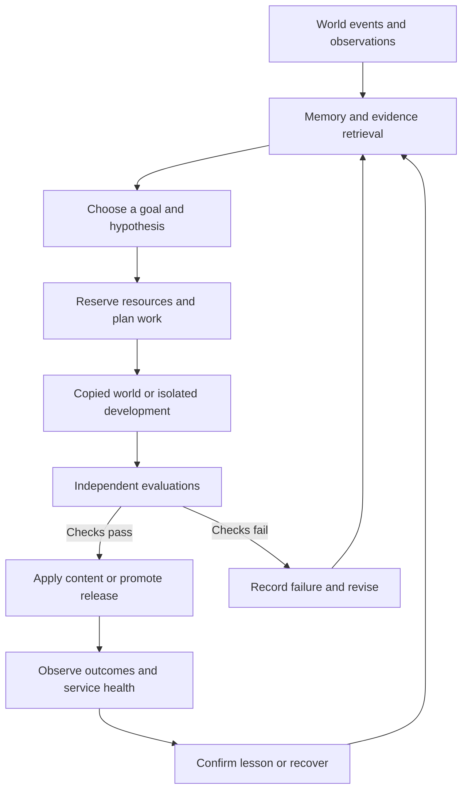

# Living World autonomous stewardship

Research and proposed architecture, 7 October 2026. This is a build specification, not a description of systems already running. The protected identity remains in [CONSTITUTION.md](CONSTITUTION.md); current implementation is described in [BASELINE.md](BASELINE.md), [MEMORY.md](MEMORY.md) and [ADMIN.md](ADMIN.md).

## The decision

The Observatory is necessary, but insufficient. It gives the owner access to records and controls; it does not yet give the world an independent developer, artist or operator. Connecting a model to those records would produce an assistant with tools. To produce the intended steward, we need a complete cycle that chooses useful work, tests its assumptions, finishes changes, recovers from failure and remembers what actually helped.

Build one coherent steward with specialized responsibilities, persistent evidence and bounded execution. Do not begin with an army of agents, continuous model training or a rewrite of the game. The intelligence should have broad creative and engineering freedom inside an independently enforced constitution and owner access/budget policy. Ordinary releases should eventually run without owner approval. The owner should be able to inspect, interrupt and redirect them.

The game must remain playable when intelligence is unavailable, slow or out of money. Intelligence proposes changes; authoritative game rules decide outcomes. An AI can expand those rules through the isolated developer/release path rather than being permanently constrained to today's effect vocabulary.

## What exists today

This assessment comes from the repository and local runtime, rather than the intended design alone.

| Area | Implemented | Material gap |
| --- | --- | --- |
| Game | Persistent shared map, server-controlled movement, resources, inventory, a quest, separate command-driven encounters, recovery and journals | A small authored seed: fixed combat, hardcoded definitions and limited strategic choices |
| History | Versioned action evidence, item provenance, observed knowledge, append-only events and migrations | Full world reconstruction, temporal belief correction, relationships and broader causal histories |
| Memory | Deterministic fact dossiers derived from player history | Retrieval across long histories, verified lessons, reusable skills and reasoning about uncertainty |
| Background work | Durable local jobs, leases, retries, deduplication and checkpoints | Durable goals/plans, long-task heartbeats, cancellation, model attempts and independent process supervision |
| Investigation | A deterministic defeat-pattern proposal | Actual hypotheses, experiments, implemented changes and measured results |
| Owner access | Protected Observatory, audit, configuration, encrypted credential storage, exports and consistent backups | Goal/evaluation/release views, enforced spending, complete emergency stop and recovery automation |
| Intelligence | OpenAI configuration and an explicit model-catalog check | No paid inference, Recognition engine, autonomous development or visual generation |
| Releases | Source control, manual startup, backup and recovery instructions | Isolated builds, independent release checks, artifact promotion and automatic recovery |

The inspected application is version 0.3.0 with schema 4. Local Node is 22.23.3 and its SQLite library is 3.51.3. The worker runs in the HTTP process, maintaining summaries and scheduling a static inspection. Its default 30-second job lease has no renewal mechanism; that is insufficient for long development work. Current replay fixtures exercise rules and supporting records, not reconstruction of every historical world state.

The owner has saved `gpt-5.6-sol` and a $10 daily ceiling. A credential is configured; its value was not read for this assessment. Inference remains disabled and the ceiling is not enforced by a spending ledger. Saved owner settings are the authority for model and budget; earlier statements that both were pending describe an older state. Asset/audio providers and their budgets are still undecided.

The localhost service persists real state. It is currently on the Windows host, not inside a configured isolated Windows Sandbox VM. The existence of a WSL command is not evidence that an isolated development environment is ready. Docker configuration has not established a tested deployment.

## What learning means here

There are several different capabilities hiding inside the phrase “learning engine.” They need different records and tests.

| Capability | What changes | How to establish that it works |
| --- | --- | --- |
| Remembering | Stored observations and retrievable context | Recover relevant facts after restart without inventing missing history |
| Understanding | Hypotheses about mechanics, players and the world | Predict outcomes on evidence not used to form the hypothesis |
| Practicing | Reusable procedures, tools and skills | Complete similar tasks more reliably, cheaply or quickly |
| Experimenting | Beliefs about which intervention helps | Compare a baseline and candidate while checking other consequences |
| Adapting | Plans, prompts, retrieval and permitted workflow choices | Improve held-out evaluations and retain previous capabilities |
| Evolving the game | Released code, content and art | Demonstrate a real before/after improvement and preserve history |
| Training model weights | Parameters of a learned model | An appropriate dataset, training access, separate cost and regression evaluations |

We need the first six. Weight training is an optional future technique, not the definition of learning. A model does not update its weights because we stored conversations or connected an API.

Voyager combines a curriculum, reusable skills and feedback without fine-tuning the underlying model. Reflexion stores linguistic feedback between attempts. These are useful architectural precedents for persistent external learning, not evidence that an unattended game developer is already solved. [Voyager](https://arxiv.org/abs/2305.16291), [Reflexion](https://arxiv.org/abs/2303.11366).

The learning unit should be an evidence-bearing lesson: a claim, context, supporting and contrary results, applicability conditions, uncertainty, expiry/review conditions and links to the original experiment. “I improved combat” is a report. “This variant reduced unavoidable defeats in these scenarios without increasing reward farming, with these unresolved limits” is a candidate lesson.

Lessons progress through proposed, tested, supported, contradicted and retired states. A changed engine version may invalidate a previously useful skill. Failed experiments stay available so the steward does not repeatedly rediscover the same dead end. Generated narratives never become historical facts merely because another agent repeated them.

## The complete operating loop

Observe authoritative events, performance, owner feedback and rendered output. Retrieve relevant history, procedures and past failures. Choose a worthwhile goal. State a hypothesis and expected benefit. Reserve resources. Work in a copied world or isolated development environment. Evaluate independently. Apply validated content or promote a release. Monitor real consequences. Retain, revise or reject the lesson. Then choose the next useful goal.

Every step needs a durable record and an explicit completion condition. A restart must resume the work rather than require a new owner prompt. Repeating an action must not duplicate rewards, releases or world mutations. An interrupted provider request can have an uncertain paid outcome; it must not be treated as a free failed call.

Useful work can arise from player experiences, operational faults, missing engine capabilities, visual weaknesses, experimental curiosity and long-term creative goals. Priority should consider impact, evidence, urgency, cost, reversibility and dependencies. Critical recovery takes precedence over a cosmetic experiment. Lack of evidence should lead to a small exploratory test, not a sweeping redesign.

Doing nothing can be correct. Do not manufacture tasks to keep the model busy, change the art style daily or endlessly polish an already satisfactory subsystem. Keep a bounded exploration allowance so the steward can discover possibilities beyond fixing known bugs.

## Authoritative world and content

Separate stable entity identity from replaceable definitions and presentation. Version maps, creatures, items, abilities, quest structures, encounter rules and assets. Existing earned objects retain their identity and provenance when their art or implementation changes. Definition migrations must state what happens to older instances.

World Intelligence should propose typed changes with referenced evidence, conditions, effects, costs, eligibility, version expectations and an idempotency key. The server validates references, permissions, fairness constraints, resource limits and current state before committing atomically. An otherwise valid proposal can become stale while waiting; revalidate at application time.

Start with a small extensible effect system rather than accepting executable text. Effects might include damage, healing, bounded status changes, resource use, item creation with provenance, quest transitions and relationship changes. Unknown mechanics become developer capability requests. The developer may implement a new effect, revise the engine or replace this representation through a compatible release. This preserves creative freedom while keeping arbitrary model text out of live execution.

JSON schemas improve output shape but do not establish truth, fairness or safety. Local semantic validation is still required. [OpenAI structured outputs](https://developers.openai.com/api/docs/guides/structured-outputs?api-mode=responses).

The broader world needs progressive support for locations, factions, relationships, ownership, teaching, ecological populations, time and causally connected quests. Introduce each when a playable loop needs it. A database with dozens of empty systems does not make the world alive.

## Durable orchestration

Extend the job foundation with goals, plans, dependencies, priorities, deadlines, cancellation, checkpoints and renewed leases. Separate the coordinator from the game process so model or build work cannot block movement and combat. Each attempt records the tool/model version, inputs, outputs, errors, usage and next checkpoint.

Use fencing tokens to reject stale workers. External side effects need idempotency or explicit reconciliation. A durable queue cannot promise exactly-once behavior from a remote provider simply because job completion is atomic locally. Timeouts, retries, cancellation and budget exhaustion must have distinct outcomes.

The first coordinator can use SQLite and the existing queue. Temporal or another durable workflow engine becomes attractive when operational complexity justifies it; it is not a prerequisite for learning. Temporal's separation of replayable workflows and external activities is a useful design reference. [Temporal workflow execution](https://docs.temporal.io/workflow-execution), [activity execution](https://docs.temporal.io/activity-execution).

Use role-specific tools and context for world interpretation, engineering, art, testing and operation. They can share one coordinator and evidence store without sharing every permission. Add concurrent agents only when measured results justify coordination costs. Research on multi-agent failures identifies specification, coordination and verification failures; more agents do not automatically mean more reliable work. [Why Do Multi-Agent LLM Systems Fail?](https://arxiv.org/abs/2503.13657).

## Model access and resource accounting

Only a provider broker should hold provider credentials. Game rules and candidate development environments should receive narrow tool interfaces, not the key. Preserve the owner's exact model and ceiling; no fallback model, asset provider or extra spending authority is selected silently.

Before sending a request, atomically reserve a conservative upper bound based on allowed input, maximum billable output and supported tool charges. All roles share the applicable owner ceiling. Record actual reported usage and reconcile reservations afterward. Unknown outcomes remain encumbered until resolved or conservatively charged. Limit concurrency, call count, execution time and retries as well as money. Recheck authorization at execution time, not only when the task was created.

Define the budget day and rollover explicitly, display them, and preserve accounting across crashes. Before inference activation, establish a conservative initial ledger state for any earlier usage that the application cannot verify. The local ceiling governs application-issued calls; separate provider caps help constrain other consumers of the same project. OpenAI now documents enforced monthly spend limits, with possible enforcement delay; these supplement a local daily ledger. [OpenAI spend limits](https://developers.openai.com/api/docs/guides/spend-limits).

For scale only: the inspected standard short-context `gpt-5.6-sol` price is $4 per million input tokens and $20 per million output tokens. A request with 4,000 uncached input tokens and 1,000 billable output tokens is approximately $0.036; 250 such requests are approximately $9 before other charges. A development job may require many calls. This is not a forecast of daily productivity; rates, reasoning/output accounting, tools and long-context pricing must be handled by the broker. [Current model specification and pricing](https://developers.openai.com/api/docs/models/gpt-5.6-sol).

Use event selection and batch interpretation, rather than a paid call for every tile movement, combat command or NPC update. Retrieve compact evidence instead of repeatedly sending the entire world. When the budget ends, save checkpoints and continue deterministic play and maintenance. CPU, memory, disk and generated asset size also require limits; a dollar ceiling does not prevent a runaway local process.

## Memory that can be corrected

Keep distinct layers:

- Authoritative facts: events, ownership, quest outcomes and observed actions, with provenance.
- Episodes: a task or encounter, its context, attempts, outcomes and unresolved issues.
- Beliefs: inferred meanings or preferences, with confidence, contrary evidence and temporal validity.
- Procedures: reusable skills, tool recipes and runbooks with prerequisites and regression checks.
- Creative context: setting rules, art direction, narrative threads and intentional design choices.
- Working state: the active plan, pending decisions and task checkpoints.

Retrieve by entity, time, event relationship, relevance and access scope. Start with indexed structured queries and full-text search. Add embeddings only after retrieval failures justify them and their provider/cost is authorized. A vector database is an indexing choice, not a learning engine. Domain relationships can initially live in relational tables.

Summaries must link back to evidence. Separate “was true then” from “is true now.” Correct outdated claims without erasing the historical record. Unknown legacy provenance remains unknown. Evaluation cases must test false memories, conflicting evidence, changed facts, missing evidence and the ability to abstain. LongMemEval's coverage of retrieval, temporal reasoning, updates and abstention provides a useful checklist. [LongMemEval](https://arxiv.org/abs/2410.10813).

NPC access is narrower than steward access. An inhabitant may know what they saw, heard or learned through a recorded relationship; they must not read every player's private journal. Rumors are beliefs, not omniscient facts. Player dialogue is data and cannot grant tool access or change developer instructions.

Memory also needs retention, deletion, minimization and access tests. Keep game-relevant preferences separate from guesses about a real person's sensitive characteristics. Send only necessary pseudonymous context to authorized providers. OpenAI API data is not used for training by default, but retention varies by endpoint and setting; disabling application storage does not itself eliminate abuse-monitoring retention. [OpenAI data controls](https://developers.openai.com/api/docs/guides/your-data).

## Experiments and evaluation

An experiment record needs the problem, hypothesis, baseline, candidate, relevant versions, primary outcome, guardrails, scenarios or cohort, resource cost, observations, uncertainty and resulting decision. Choose success criteria before inspecting results. Record negative outcomes and inconclusive trials.

Use several kinds of evidence:

| Evaluation | What it establishes | What it cannot establish alone |
| --- | --- | --- |
| Authoritative rule tests | Correct outcomes and invariants | Enjoyment or artistic identity |
| Saved-world migration tests | Compatibility with representative histories | Compatibility with every unseen history |
| Paired simulations | Differences under controlled starting conditions | How people will feel about them |
| Rendered screenshots and animation captures | What the player actually sees | Long-term narrative satisfaction |
| Structured critic judgments | A useful view of clarity or coherence | Objective proof that a change is better |
| Real play sessions and owner feedback | Experienced confusion, agency and enjoyment | Universal preferences or clean causality from small samples |
| Live monitoring | Regressions and actual operational outcomes | Why an observed correlation occurred |

Compare variants with paired scenarios and controlled random seeds, then broaden scenarios to expose overfitting. Simulation bots should represent cautious players, explorers, collectors, aggressive fighters and exploit attempts. Label synthetic evidence explicitly. Do not promote a lesson solely from a successful generated explanation or a single favorable run.

An LLM critic is useful but subject to positional, verbosity and self-preference biases. Blind candidate labels, vary order, use explicit rubrics and compare against objective checks and human calibration. A second prompt to the same model is not independent ground truth. [Judging LLM-as-a-Judge](https://arxiv.org/abs/2306.05685).

Keep a protected set of constitutional and authorization checks outside candidate write access. Ordinary quality tests remain improvable, with their changes and evidence recorded. Track evaluation-suite versions so the developer cannot claim an improvement merely by removing a failing test. Public-facing experiments must avoid inconsistent shared-world facts, unfair rewards and irreversible identity changes.

Store evaluations in portable project-owned records and exportable artifacts. OpenAI's published deprecation schedule includes hosted Evals becoming read-only on 31 October 2026 and shutting down on 30 November, alongside restrictions and a planned end to self-serve fine-tuning job creation. Do not make either service the foundation of persistent learning. [OpenAI deprecations](https://developers.openai.com/api/docs/deprecations). A local runner can export JSON/JUnit results; Promptfoo is one optional tool, not a required platform. [Evaluation result exports](https://www.promptfoo.dev/docs/configuration/outputs/).

## World Recognition and NPC life

Recognition should interpret patterns with context: effort, risk, alternatives, refusal, persistence, relationships and consequences. Repetition alone should not create a guaranteed reward schedule. A valid result may be no Recognition, an invitation, a minor skill, a new lineage or a request for an engine capability.

Store proposed identity, evidence, counter-evidence, confidence, novelty, existing related paths, power costs, counterplay and player consent requirements. Distinguish an originator from someone who later learns or independently develops a related path. Teaching and lineage must have server-defined rules; a model description does not transfer ownership or confer unlimited power.

For example, repeatedly protecting companions while vulnerable could suggest a path. First check whether this reflects meaningful choices rather than coordinated farming. Propose a bounded ability with tradeoffs and a refusal option. Test it against combat and reward abuse. Only an applied, audited decision becomes real history. The current landmark discovery system is not this capability.

NPC life needs observations, beliefs, relationships, goals and feasible plans. Use deterministic simulation for routine movement and time. Call a model for meaningful interpretation or plan changes, then validate actions against the physical world. NPCs can misunderstand events; the authoritative state cannot. Generative Agents demonstrates a useful memory/reflection/planning pattern in a small sandbox, not production-scale reliability. [Generative Agents](https://arxiv.org/abs/2304.03442).

The director should preserve unresolved mysteries, causal threads, quiet periods and opportunities outside the most popular activity. World budgets constrain rare rewards, resource creation and simultaneous dramatic events. A world that makes every action extraordinary soon loses meaningful contrast.

## Gameplay and human experience

The experimental autonomy does not remove the need for a compelling game. The starter attack/guard/heal/retreat system offers limited tactical depth. The next design work should investigate meaningful command choices, enemy intent, resource pressure, status effects, equipment and optional party/initiative systems within the constitution. Do not add each because it appears on an RPG checklist.

Use observed problems to select a small change. If defeated players did not understand an enemy, investigate presentation before reducing difficulty. If guard has little purpose in the current encounter rules, test a mechanic that gives it a situational role. If a powerful skill removes choices, introduce an interesting cost rather than endlessly increasing enemy health.

Track comprehension, available choices, counterplay, fairness, coherent consequences and voluntary return. Treat raw session length or retention as secondary observations, not the steward's master objective. Research links autonomy, competence and relatedness to enjoyment, giving useful directions to investigate rather than a guaranteed formula. [Ryan, Rigby and Przybylski](https://selfdeterminationtheory.org/wp-content/uploads/2020/10/2006_RyanRigbyPrzybylski_MandE.pdf).

Before a public economy, establish item conservation, ownership transitions, trade/crafting duplication checks and recovery from simultaneous requests. Before social systems, establish moderation rules and abuse controls. Before large procedural regions, validate reachability, collision, resource access and escape routes. Procedural generation research is relevant, but reinforcement learning for maps is an optional later method; a generator plus functional validators is a better first experiment. [PCGRL](https://arxiv.org/abs/2001.09212).

## A world copy for testing

Create a consistent copy of world state, definitions, asset versions, clock configuration and random state. Record exactly which snapshot and engine version each experiment used. Provide deterministic clocks and seeded randomness where practical. Run migrations and candidate gameplay against old and new saved-world fixtures.

The copied world should exercise multi-player interactions, duplicate commands, disconnected clients, stale proposals, failed jobs and interrupted releases. Test properties such as unique ownership, bounded rewards, reachable quest states, legal movement and NPC privacy. Keep a few representative long histories as well as clean new-player states.

A copy is not a perfect digital twin of human behavior. Our existing event records also do not support complete historical reconstruction. Begin with snapshots and replayable test actions; add more event coverage where recovery and experiments need it. Never invent missing old events to make a replay appear complete.

Simulation can discover a soft lock or exploit without spending player progress. It cannot prove that a quest is emotionally satisfying. Human play remains valuable calibration, while routine engineering and releases remain independently executable.

## Autonomous development and visual evolution

Give the developer a real coding harness: inspect the repository, edit files, run permitted commands, use documentation, test, inspect a browser and package artifacts. Adapt an existing maintained harness through an interface rather than reducing development to “return some code.” SWE-agent research illustrates why the agent's working interface matters. [SWE-agent](https://arxiv.org/abs/2405.15793). OpenAI offers an Agents API/harness, but integration and account availability must be verified before selecting that implementation. [Agents API overview](https://developers.openai.com/api/docs/guides/agents-api/overview).

Use isolated source copies with minimized test data and separate identities. Candidate execution receives neither live database write access, owner credentials, the seal key nor permission to modify the independent validator. Define filesystem mounts, permitted network destinations, package access, resource limits and tool contracts explicitly. A branch or folder is source separation, not OS isolation.

For Windows bootstrap, a persistent Linux VM can provide closer server parity; a configured Windows Sandbox can be a disposable candidate runner. Select the environment after checking local support. Windows Sandbox configuration matters: default networking and clipboard access and writable mapped folders can expose host resources. Persistent game data stays outside a disposable sandbox. [Microsoft Windows Sandbox configuration](https://learn.microsoft.com/en-us/windows/security/application-security/application-isolation/windows-sandbox/windows-sandbox-configure-using-wsb-file).

Record dependency locks, build commands, artifacts, migration requirements, test evidence and source hashes. Package upgrades need compatibility and supply-chain checks. Limit candidate network access rather than giving generated code arbitrary internet access. An isolated developer can still creatively replace the renderer, database adapter or combat architecture when the resulting release preserves protected behavior.

Visual improvement requires its own complete pipeline:

1. Observe actual scenes and animations; identify a concrete weakness or creative need.
2. Retrieve a versioned art bible: original identity, palette, pixel scale, silhouettes, directions, frame conventions, anchors and interface language.
3. Generate alternatives through code or an explicitly authorized asset adapter.
4. Compile sprites, tiles, animation metadata and versioned manifests.
5. Validate dimensions, transparency, frame completeness, seams, collision alignment and file size.
6. Inspect rendered desktop/mobile scenes, motion, readability, accessibility and frame performance.
7. Release the asset/presentation bundle and observe consequences.

The selected text model can inspect image inputs, but does not output raster images. It can improve procedural canvas art, code, SVG and animation logic within its existing authority. Image/audio generation requires a separate supported adapter and owner-set spending authority. A generated picture is not automatically a usable sprite sheet. Atlas tooling such as Aseprite's batch exporter can help produce consistent frames and metadata if selected. [Model modalities](https://developers.openai.com/api/docs/models/gpt-5.6-sol), [Aseprite command-line exports](https://www.aseprite.org/docs/cli/).

Preserve stable object identities and readable silhouettes while evolving art direction. Record asset provenance and actual rights information; do not invent missing licenses. Keep old bundles available. A visual update must not accidentally change collision or combat. Sound and music need equivalent identity, accessibility, volume and provenance checks when introduced.

## Independent releases and operation

Separate proposal creation from permission enforcement and artifact promotion. The developer produces a candidate; a separately protected broker checks the constitution, owner policy, evidence, migration compatibility and recovery plan before promotion. OS identities and write permissions matter more than telling the developer to be careful. This is a boundary around authority, not a ban on substantial changes. Excessive permissions are a recognized failure mode in tool-using agents. [OWASP excessive agency](https://genai.owasp.org/llmrisk/llm062025-excessive-agency/).

A release record needs source/build hashes, content and asset versions, compatible schemas, test results, expected benefit, health criteria, observation window and recovery options. Stage in a copied world first. On the initial single-writer world, use a controlled drain/restart and feature flags where applicable rather than pretending that two instances can safely canary arbitrary shared-state changes. General canary principles remain useful. [Google SRE canarying](https://sre.google/workbook/canarying-releases/).

Back up before migration. Prefer additive, compatible transitions: expand, migrate, then contract after the old version is no longer needed. A code rollback is valid only when the retained schema and newly written data remain compatible. Otherwise use a tested forward repair or controlled maintenance. [Parallel change](https://martinfowler.com/bliki/ParallelChange.html).

Restoring yesterday's database can erase today's player progress. Do not label that an ordinary rollback. Separate code rollback, asset rollback, content disablement, migration repair and disaster restore. Recovery must preserve newer authoritative events and transactions when possible; replay requires actual tested coverage. If safe recovery cannot meet the history commitment, contain the incident and expose the exception rather than silently deleting history.

Operator responsibilities include process supervision, bounded restarts, latency/error monitoring, disk and database checks, queue lag, backup scheduling and tested restoration. Keep backups independent of candidate write access and eventually off-host. Preserve and protect the credential seal separately. Trace a task through model calls, tools, experiments and releases with common identifiers; logs alone do not replace domain evidence. [OpenTelemetry signals](https://opentelemetry.io/docs/concepts/signals/).

The emergency stop must revoke new model/tool/release work, checkpoint active tasks and handle already running actions; it must not be confused with today's memory-worker pause. The deterministic game should continue when possible. Operator recovery follows explicit runbooks and policies, not unrestricted administrative shell access.

Before public hosting, add player accounts/recovery, HTTPS, proxy/origin configuration, authorization, abuse limits, telemetry, declared capacity and tested deploy/recovery procedures. Keep one server and one local SQLite volume until measurements justify change. WAL permits concurrent readers but a single writer and requires same-host access. The inspected SQLite 3.51.3 contains the documented WAL-reset fix; verify the library in future packaged runtimes too. [SQLite WAL documentation](https://sqlite.org/wal.html).

## What the Observatory should show

The owner should be able to answer: what is the steward trying to improve, why, what did it spend, what changed, did it work, and what happens if it fails?

Add active goals and priorities; plans and checkpoints; evidence and uncertainty; experiments and baseline/candidate results; lessons promoted or contradicted; skill/prompt/evaluation versions; before/after art captures; current world/content/asset/release versions; cost reservations and unresolved charges; incidents and recovery status. Explain whether it is working, waiting for evidence, out of budget, recovering or outside authorization.

An owner request becomes a durable goal with scope and completion criteria. Feedback can change future choices without erasing failed evidence. Requests to change protected identity, budgets or access remain explicit owner decisions. Player text and candidate output cannot impersonate those decisions.

## Proposed records and interfaces

These are logical contracts, not a demand for one database table per row or a new framework. Add versioned migrations with live backups when implementation begins.

| Record or interface | Required information |
| --- | --- |
| Goal and plan | Origin, scope, priority, dependencies, completion criteria, status, checkpoint |
| Attempt and trace | Goal/job, tool/model/prompt versions, sanitized evidence, outputs, errors, timings |
| Budget reservation and usage | Owner policy version, day, maximum charge, actual/uncertain charge, reconciliation |
| Memory claim | Source evidence, subject, validity interval, access scope, uncertainty, supersession |
| Lesson and skill | Evidence, applicability, dependencies, tests, supported/contradicted status |
| Experiment | Hypothesis, baseline/candidate, scenarios, measures, guardrails, uncertainty, decision |
| World proposal | Typed effects, evidence, expected versions, consent, policy checks, idempotency |
| Content and asset bundle | Stable IDs, version, dependencies, provenance, compatibility and manifest |
| Candidate and release | Immutable artifacts, migration plan, independent checks, health/recovery criteria |
| Incident | Detection, impact, permitted actions, recovery evidence, resulting lesson |

Useful service boundaries are `observe`, `retrieveEvidence`, `selectGoal`, `reserveUsage`, `runAttempt`, `evaluateCandidate`, `applyWorldProposal`, `promoteRelease`, `verifyOutcome` and `recordLesson`. They must return typed results and durable identifiers. Untrusted text is never a substitute for a successful execution receipt.

## Failure cases we must exercise

| Failure | Required response and proof |
| --- | --- |
| Concurrent calls approach the daily ceiling | Atomic reservation rejects excess work; totals survive restart |
| Provider timeout after submission | Preserve uncertain charge, reconcile or charge conservatively; no blind free retry |
| Model emits valid-shaped but false content | Evidence/reference/effect validation rejects it |
| Player embeds developer instructions in chat | No new privilege or policy mutation; NPC treats it as dialogue |
| Summary invents a past action | Retrieval retains provenance; memory evaluation catches the false claim |
| Old fact is no longer true | New evidence updates current belief while preserving past validity |
| Developer changes its own gate | Independent permissions prevent modification and promotion |
| Long task loses its worker | Lease/checkpoint recovery resumes; stale completion cannot publish |
| World changes during interpretation | Application detects stale versions and reevaluates |
| Two players race a unique reward | One atomic authoritative outcome; no duplicate ownership |
| Migration fails halfway | Tested transaction/recovery behavior preserves old state and service options |
| Candidate passes its own tests but regresses history | Protected saved-world checks block promotion |
| Visual critic likes unusable art | Frame, collision, actual-scene and performance checks reject it |
| Released code fails health checks | Compatible rollback or forward repair; newer progress is retained |
| Database restore would erase newer history | Contain and follow explicit disaster recovery; no silent reset |
| Model unavailable or budget exhausted | Game stays playable; durable tasks wait without loops |
| Disk fills or backup is unusable | Alert/contain, verify recovery copy, avoid destructive cleanup guesses |
| Steward repeats a failed idea | Retrieve failure evidence and require a materially new hypothesis |
| Engagement rises but agency falls | Guardrails reject the supposed improvement |

## Build order and acceptance

Build through complete vertical slices. Each phase should demonstrate a closed cycle, rather than collecting disconnected modules.

1. **Durable learning and metered shadow work.** Add goal/attempt/experiment/lesson records, renewable jobs, a provider broker, atomic budget tests and Observatory evidence views. Begin with a mock provider and disabled live inference. Demonstrate recovery across restart, uncertain charges, memory correction and a negative experiment. This is the next implementation package.
2. **One real World Intelligence cycle.** With explicit inference activation inside saved owner limits, interpret bounded histories and generate shadow proposals. Then apply one compatible skill and one personal quest through validated effects. Exercise refusal, duplicate delivery, stale state, reward limits and provenance. Record actual outcomes rather than declaring generation an improvement.
3. **Isolated development and creative cycle.** Establish a tested OS boundary, world copies, browser inspection and artifact packaging. Complete one self-selected code improvement and one visual improvement; inspect rendered output and retain failed variants. Generation adapters remain optional until separately authorized.
4. **Independent release and operator cycle.** Implement protected promotion, migration compatibility, complete emergency stop, process supervision and incident runbooks. Deliberately break a candidate and a release. Verify recovery without erasing newly earned progress, then let the steward diagnose and retry.
5. **Sustained unattended trial.** Run a proposed 72-hour local trial that completes useful gameplay, visual and operational work, survives provider/job/service failures, honors accounting and stops needless churn. Publish traces, results and limitations. A trial duration is a gate to test, not a claim that reliability has been achieved.
6. **Server transfer and invite-only alpha.** Deploy the same versioned artifacts and consistent saved world with account/security/operations gates passed. Run restore and capacity tests on the actual host. Use real play evidence to calibrate what the bots and critics missed.

Useful first proof: the steward observes an encounter problem, states two competing explanations, tests a small candidate in a world copy, rejects a failed version, implements a better variant and its presentation, passes independent checks, releases it, verifies preserved player history and stores a qualified lesson. This exercises learning, engineering, art and operation together.

Keep advanced model training, elaborate multi-agent hierarchies, a distributed graph stack, large-scale RL, a full economy and multi-shard hosting out of the critical path. Revisit them when a measured limitation establishes a need. These are replaceable choices, not constitutional prohibitions.

## What we can honestly claim

Research supports memory, reusable procedures, feedback loops, durable execution and measured iteration as practical building blocks. It does not establish that a fully unattended creative MMO steward will reliably preserve taste, fairness and continuity forever. Independent checks reduce failure risk; they cannot mathematically prove that every future redesign is enjoyable.

The experiment becomes credible when it produces inspectable changes, measured outcomes, failed attempts, recovery evidence and continued independent work within owner boundaries. The test is not whether it says it learned. The test is whether its next decision improves because of what actually happened.

OpenAI's own agent-improvement example connects traces and evaluation to implementation and validation, which is a useful reference for this closed cycle. Our domain evidence, history safeguards and creative evaluations still need to be built. [Agent improvement loop](https://developers.openai.com/cookbook/examples/agents_sdk/agent_improvement_loop).
