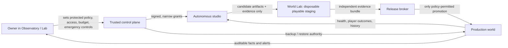

# Autonomous operation readiness audit

**Audited 11 October 2026.** This is the operating specification for an AI that develops, evolves, releases and runs Living World while the owner supervises only through the Observatory/Lab. It is an honest assessment of the local build, not a claim that this level of autonomy already exists.

## Verdict

Living World has a credible **foundation**: an authoritative persistent RPG, protected creative identity, durable history and jobs, an owner Observatory, a project-specific Codex developer that works in an isolated source copy, outcome memory, and a small validated visual-data release lane. The local service is healthy at `v0.5.0`, schema `6`; its status reports `modelCallsEnabled: false`.

It is **not ready to run an entire game by itself**. The main missing product is the **World Lab**: a disposable, playable candidate world where an autonomous change can be built, migrated, exercised by several kinds of tester, evaluated as an experience, and either promoted by an independent broker or rejected. Until that exists, general code release, generated live narrative, visual judgement, unattended recovery, public operations, and genuine World Intelligence must remain outside autonomous authority.

The target is not an agent with unlimited control. It is a capable game studio inside a trusted operating boundary: free to choose ordinary work and ship changes that clear proven gates; unable to change the constitution, its own authority, budget, secrets, release policy, audit history, or player history.

## The intended authority model

### What the AI owns day to day

Within its granted capability band, the studio selects problems from world evidence and its own backlog; designs systems and content; creates and revises original visuals, sound, maps, dialogue and encounter rules; writes code; runs simulations and browser playthroughs; studies results; deploys changes that independently pass the active release policy; monitors the world; and initiates a bounded rollback or recovery when its runbook permits it.

That includes changing ordinary systems when evidence supports the change. It must not be frozen into today's engine, sprite format, combat balance or content structure. The Constitution protects the game's identity and the owner controls the external authority; it does not prescribe implementation.

### What remains exclusively in the Lab

The owner should operate the project through a small set of **control-plane controls**, not through routine feature approval:

| Lab authority | Why it stays outside the agent | Required behaviour |
| --- | --- | --- |
| Constitution and protected commitments | Defines the experiment and prevents an identity reversal | Owner-signed changes only; every version remains readable and immutable. |
| Provider, model, spend, run time and rate ceilings | Prevents a tool loop from creating uncontrolled financial exposure | The broker reserves budget before work, records actual usage, and denies over-cap work. |
| Network, credential and integration grants | A generated task must never gain new outside reach by asking for it | Purpose-specific, expiring grants; secrets are brokered, never revealed to a candidate workspace. |
| Release bands | Lets the owner decide what categories may auto-promote as trust grows | The agent releases freely *within* the active band; policy widening is an owner action. |
| Emergency pause, revocation, restore and read-only mode | Separates incident control from the agent being investigated | Immediate, logged, available even when the game or agent is unhealthy. |
| Data retention, player-safety and moderation policy | These are obligations to players, not creative choices for a model | The agent applies a versioned policy; the Lab sets it and exposes its enforcement record. |

The Lab must not offer raw production SQL, an unrestricted browser shell, editable audit logs, or a hidden prompt field that bypasses the control plane. It should show evidence, plans, evaluated alternatives, costs, incidents, release manifests, world history and recovery records without exposing secrets.

## What a whole autonomous game studio actually needs

The following audit covers the work normally divided among a creative director, systems designer, writer, artist, engineer, test team, producer, release manager, SRE, community team and security engineer. A role can be implemented by one agent loop at first; its **evidence boundary** must still exist.

| Capability | The autonomous studio needs | Current Living World state | What proves readiness |
| --- | --- | --- | --- |
| Product direction | A versioned creative north star, gameplay pillars, prohibited IP imitation, measurable player promises and a change-impact record | **Partial.** Constitution and baseline protect the core identity. No machine-checkable commitment evaluator yet. | Candidate change names the commitments it touches; an independent check rejects incompatible changes and records the decision. |
| World and systems design | A model of player loops, pacing, balance, encounter choices, progression, economy and emergent consequences; simulation before live changes | **Early.** Command-driven encounters and server authority exist; the seed world has no full systems-design simulator. | Deterministic replay and scenario simulations establish that a change improves a stated objective without breaking saved histories. |
| Persistent-world memory | Event provenance, fact dossiers, retrieval with confidence/coverage, player/NPC/world histories, conflict detection and retention controls | **Partial.** Durable events, facts, jobs and deterministic summaries exist. No semantic retrieval, canonical relationship graph or replayable reconstruction. | A generated proposal names the exact evidence it relied on, abstains when evidence is insufficient, and survives replay and duplicate delivery. |
| World Intelligence and narrative | Structured proposals for Recognition, quests, NPC action and ecology; canonical facts; a commitment ledger; contradiction, refusal and expiry handling | **Missing as live intelligence.** No provider inference or live generated content; current landmark discovery is deterministic. | Shadow proposals pass adversarial story tests: refusal, delay, death, reconnect, concurrent players and conflicting evidence. No free-form model text mutates the world. |
| Content production | Original creature, location, item, quest and encounter pipelines with reusable primitives, licensing/provenance, diversity and editorial coherence | **Early.** Seed data and visual-data packs exist. | Each asset/content pack has provenance, a manifest, compatibility/version checks and scene-level evidence in the Lab. |
| Art, animation, sound and UX | An art bible, palette/style constraints that can evolve, asset generation/selection, animation and audio tooling, accessibility checks, and visual regression review | **Early.** Validated JSON visual-release lane exists; no scene critic, asset pipeline or audio lane. | Contact sheets and actual rendered scenes pass visual and accessibility checks; novelty and coherence are measured across a portfolio, not by one "best" image. |
| Engineering | Repository understanding, scoped implementation, dependency and supply-chain review, code quality, migrations, compatibility and rollback design | **Partial.** Codex can alter an isolated source copy and run offline checks. It cannot safely operate a full candidate service. | The exact immutable candidate artifact builds in a clean environment, passes required checks and produces a machine-readable change manifest. |
| Game QA and playtesting | Unit, integration, migration, load and property tests plus browser playthroughs by contract, explorer and intent-driven testers | **Partial.** Gameplay/persistence/job tests and candidate offline checks exist. No isolated browser staging. | A candidate world report includes assertion results, seeded playthrough recordings/screenshots, performance data and known limitations. |
| Evaluation and learning | Hypotheses, baselines, success/failure measures, player-outcome analysis, counterfactuals, lessons and calibrated critics | **Early.** Outcome memory records developer results. No experiment framework, evaluation dataset or player-experience calibration. | Every change closes with observed results versus prediction; lessons update prioritisation only after evidence, never silently rewrite policy. |
| Planning and coordination | A durable work queue, dependency graph, specialist tool profiles, interruption recovery, duplicate prevention and truthful status | **Partial.** Durable jobs, bounded self-selected work and developer runs exist. | A long autonomous run resumes safely after interruption, never executes the same consequential work twice, and exposes its reasoning inputs and artifact IDs. |
| Release engineering | Reproducible build, artifact attestation, staging, health/readiness gates, canary/rollback, migration backup, restore drills and release observations | **Early.** Backups and a limited visual-data publication/rollback lane exist. General source promotion does not. | The independently tested artifact, not a rebuilt substitute, is promoted; a forced failure rolls back and a restore drill preserves representative player history. |
| Live operations | Metrics, logs, traces, SLOs, queue and cost telemetry, alert routing, incident playbooks, capacity controls and safe recovery | **Foundation only.** Health endpoint and local operation exist; no unattended host recovery or operational SLO loop. | The agent detects injected dependency, process and data failures; follows a bounded runbook; escalates when outside it; and records the incident. |
| Player and community operation | Account/session security, chat/name/report moderation, appeals, privacy/retention, abuse handling, support queues and clear player communication | **Future public-launch work.** Local guest access is suitable only for the sandbox. | Public test environment proves isolation between accounts, moderation-policy enforcement, auditability and recovery of player support cases. |
| Infrastructure and security | Separated identities and environments, network allowlists, secret broker, dependency/update policy, backups, restore verification and attack testing | **Partial.** Source copies have a narrow profile; the local host is not yet a disposable VM/container World Lab. | Candidates cannot read production secrets, connect to production, alter the broker, or bypass the validator—even when their generated code is hostile. |
| Cost and capacity governance | Per-role budgets, token/runtime/asset limits, quotas, reserve-before-run accounting, anomaly detection and provider failover policy | **Partial.** Developer daily run/time limits exist; World Intelligence calls are disabled. | Actual costs reconcile with reservations, cap breaches fail closed, and a provider outage produces a graceful degraded mode. |
| Governance and audit | Immutable decision log, policy versions, model/tool manifests, input/output provenance, release records, access review and owner-readable exports | **Partial.** History and development records exist, but there is no independent full control-plane ledger. | Every consequential action can be reconstructed from policy version, actor, capability grant, inputs, artifact hash, validator result, and outcome. |

## The non-negotiable technical boundaries

Autonomy is safe only when the system that grants authority is stronger than the system that spends it. The trusted control plane needs to run separately from candidate code and keep the following powers itself:

1. **Policy enforcement, not prompt enforcement.** The model may propose an action, but a trusted broker validates its capability, scope, budget, idempotency key and release band before any effect. OWASP explicitly recommends minimizing tools and permissions, avoiding open-ended tools, and enforcing authorization in downstream code rather than letting the model decide what is allowed. [OWASP: Excessive Agency](https://genai.owasp.org/llmrisk/llm062025-excessive-agency/)
2. **One-way candidate environment.** Candidate code receives a fresh workspace, synthetic or restored staging data, a narrow artifact export channel and no production credential. It cannot edit the constitution, release validator, broker, audit ledger or backups. OpenAI's sandbox guidance similarly separates a trusted control plane from the execution workspace and requires an explicit workspace/lifecycle contract. [Sandbox Agents](https://developers.openai.com/api/docs/guides/agents/sandboxes) [Sandbox security](https://developers.openai.com/api/docs/guides/agents/sandboxes#security)
3. **Independent release broker.** A developer cannot mark its own work as safe. The broker takes only a content-addressed candidate artifact and a signed evidence bundle, reruns required independent checks, takes the required backup, and makes one atomic promotion or a recorded refusal. Build provenance gives the owner a way to trace what was actually deployed. [SLSA security levels](https://slsa.dev/spec/v1.1/levels)
4. **Server authority and typed effects.** Player text, retrieved documents and model output remain untrusted data. The world accepts only versioned, typed effects checked against current state and policy; it records a receipt so retry cannot create a duplicate event.
5. **Recovery outside the agent.** A candidate may request rollback or start a documented recovery runbook, but independent backup/restore tooling remains available when the agent process, model provider or game server is down. Sandbox lifecycle guidance also warns that an idle or disconnected session is not a safe automatic recovery point; workspaces need explicit snapshots and lifecycle coordination. [Sandbox lifecycle](https://developers.openai.com/api/docs/guides/agents/sandboxes#lifecycle)

## The World Lab: the next essential product

The World Lab is not a generic sandbox. It is the autonomous studio's test world and its evidence factory.

### Required input contract

| Input | Requirement |
| --- | --- |
| Candidate | Immutable source/artifact hash, requested capabilities, expected changes, migration and rollback plan. |
| World fixture | Sanitised, versioned copy or synthetic scenario set; never the live database or production secrets. |
| Policy | Read-only active constitution, release band, resource ceiling and test plan. |
| Test actors | Contract player, exploratory player, intent-driven player, hostile input source and load actor. |
| Instrumentation | Structured game events, client/server errors, timings, screenshots/recordings, logs and trace IDs. |

### Required output contract

| Evidence | Minimum question it answers |
| --- | --- |
| Build and provenance manifest | What exact code/assets/dependencies were evaluated? |
| Test report | Did rules, persistence, migrations, retries, restore and acceptance checks pass? |
| Experience report | Could players see/read/use the changed content? Did the intended encounter, story or UI behaviour occur? |
| Compatibility report | What happens to saved history, old clients and incomplete actions? |
| Risk and rollback report | What could fail, what was injected, and can the tested artifact be reversed? |
| Decision record | Which independent policy checks passed/failed, and why was it promoted or rejected? |

The Lab requires **three player perspectives**. A contract player checks known assertions; an explorer pursues novel routes and collision/soft-lock signals; an intent player evaluates whether the actual fantasy is clear (for example, whether Guard becomes an informed combat choice rather than a meaningless button). Pixel-level game testing research supports combining automated screen exploration with a human investigator rather than assuming rule tests see playability. [Inspector: Pixel-based Game Testing](https://arxiv.org/abs/2107.13717)

For World Intelligence, the Lab also needs a canonical narrative state and a commitment ledger: promises, prerequisites, current owner, expiry, allowed resolutions, visible framing and tests. Research on game quest generation emphasizes grounding quests in an action/object graph, and recent narrative-agent work points toward explicit structured state rather than prose-only memory. These are design directions to validate in Living World, not proofs that a model will maintain continuity automatically. [Quest generation with graph grounding](https://arxiv.org/abs/2405.15817) [Orchestrated Reality](https://arxiv.org/abs/2509.11303)

## Evaluation that stops the world becoming worse over time

The studio cannot learn from a single pass/fail test. It needs a versioned evaluation suite that grows from actual defects and player outcomes:

| Evaluation layer | Examples | Promotion use |
| --- | --- | --- |
| Invariants | Server authority, no duplicate receipts, ownership, combat legality, migration/restore, no secret access | Required for every release. |
| Regression fixtures | Historic player journeys, prior incidents, saved worlds, known edge cases | Required when relevant systems change. |
| Experience checks | Scene readability, control response, encounter choice, accessibility, narrative clarity | Required for player-facing changes. |
| Creative portfolio checks | Style coherence, perceptual novelty, composition/palette constraints, content repetition | Required for visual/narrative packs. |
| World-intelligence checks | Evidence citation, abstention, contradiction, commitment survival, duplicate proposal behaviour | Shadow-only until calibrated. |
| Live observation | Error rate, performance, player exits, completion/retreat patterns, reports, spend | Controls canary expansion and rollback. |

Trace first, then turn repeated scenarios into versioned datasets and graders. OpenAI's current agent-evaluation guidance makes the same distinction: traces are useful for debugging, while datasets and repeatable evaluation runs are needed for reliable comparison. [OpenAI agent evals](https://developers.openai.com/api/docs/guides/agents/evals)

An LLM may help critique a scene or narrative, but it cannot be the only judge of its own work. Use deterministic constraints, multiple independent critics, held-out cases and periodic player/owner calibration. Quality-diversity research also supports preserving a portfolio of good, different content rather than repeatedly optimizing one score until the game homogenizes. [Quality Diversity for PCG](https://arxiv.org/abs/1702.00509)

## Authority ladder and acceptance gates

Autonomy should expand by demonstrated capability, not by optimism. The owner changes only the release band; the studio chooses the work inside it.

| Band | Agent may do without routine owner approval | Gate before entry | Current status |
| --- | --- | --- | --- |
| A — Observe and propose | Read sanitized evidence; create plans, source candidates and shadow content; run offline tests | Immutable logs, strict tool scope, no production effects | **Operating in part.** |
| B — Reversible data evolution | Publish validated visual/content data behind versioning; rollback within policy | Lab-style validation, compatibility check, one-command rollback and release record | **Operating only for narrow visual-data packs.** |
| C — Staged code evolution | Run candidate service/migrations and browser tests; create a promotable artifact | World Lab, isolated credentials/network, independent evaluator, restore drill | **Not built.** |
| D — Limited automatic production promotion | Promote low-risk scoped code/data changes; observe and auto-rollback inside thresholds | Proven canary/rollback, SLOs, provenance, incident escalation and repeated drills | **Not built.** |
| E — World Intelligence in production | Apply bounded Recognition/quest/ecology effects with declared evidence | Provider budget enforcement, typed effects, retrieval coverage, narrative evaluations and rollback | **Not built; inference disabled.** |
| F — Unattended stewardship | Prioritise, develop, release, operate and recover within all policies | Sustained local trial, chaos/restore drills, audit completeness and no unresolved policy breaches | **Future destination.** |

A measured local trial is the final gate, not a slogan: run the enabled bands for a defined period against injected failures, scheduled backups, candidate regressions and cost/provider interruptions. The acceptance record must show what the studio changed, what it rejected, each budget reservation, each promotion/rollback, each failed recovery and the player-history result after restore. NIST's Generative AI profile usefully frames this as governance, provenance, pre-deployment testing and incident disclosure across the lifecycle. [NIST AI 600-1](https://nvlpubs.nist.gov/nistpubs/ai/NIST.AI.600-1.pdf)

## Observatory/Lab product requirements

The existing `/admin` Observatory has the right starting roles—world inspection, work records, memory worker controls, provider setup, Codex development, backups and Constitution visibility. To supervise a real autonomous studio without becoming its day-to-day producer, it needs these additions:

1. **Mission & policy:** current constitutional version, protected-commitment impact map, signed policy versions, release-band selector and a diff view for owner changes.
2. **Autonomy console:** enabled loops, next scheduled work, active capability grants, queue/dependency view, current spend/runtime, reservations and safe pause/revoke controls.
3. **World Lab:** candidate inventory, environment lifecycle, exact fixture, test actor recordings, screenshots, browser results, experience report and clear promotion/rejection reason.
4. **Release & recovery:** artifact/provenance manifest, canary state, current health thresholds, rollback action, backup freshness, last successful restore drill and incident timeline.
5. **Creative and narrative portfolio:** art/contact-sheet evolution, style/version lineage, content diversity, active story commitments, unresolved contradictions and generated-content provenance.
6. **World and player health:** server SLOs, errors, latency, queue depth, performance, world vitality, player reports, moderation outcomes and data-retention status.
7. **Audit export:** append-only decisions, tool calls, grants, model/tool versions, evidence hashes, costs, release history and unredacted-for-owner backup verification—while keeping raw secrets absent from the UI.

These are supervisory controls, not routine gates. A healthy Lab should let the owner understand **why** the game changed and stop or bound the system in an incident, while the studio continues to create, test and improve on its own.

## Priority build order

1. **Build the World Lab control plane.** Start with a disposable Windows Sandbox/container-compatible candidate service, synthetic fixtures, blocked production network, artifact export and lifecycle/snapshot rules. Do not run candidate code on the privileged local service.
2. **Make an independent evaluator and release broker.** Artifact hashes, build manifest, required tests, migration backup/restore, browser evidence and policy-controlled rejection come before code auto-promotion.
3. **Expand the evaluation suite.** Add deterministic replay, migration/restore fixtures, browser contract/explorer/intent tests, visual/accessibility checks and a regression corpus from every defect.
4. **Build the provider and world-intelligence broker in shadow mode.** Keep model and budget owner-configured; add reserve-before-call cost enforcement, evidence retrieval, typed proposals, abstention and narrative commitment tests before any live effect.
5. **Build the full creative pipeline.** Original-asset provenance, art bible that can evolve, visual portfolio scoring, scene rendering review, audio/accessibility and content-pack compatibility.
6. **Add staged promotion and operations.** Low-risk canaries, SLOs, rollback thresholds, incident playbooks, service/backup failure drills and reporting.
7. **Prepare public operation only after the local trial.** Account security, moderation, privacy/retention, observability, hosting capacity and public launch gates belong after the autonomous local system proves itself.

## Current status, stated plainly

- The game can run locally as an authoritative browser RPG and retains meaningful world history.
- The owner has a functioning Lab/Observatory foundation and a bounded Codex account development path.
- The developer has demonstrated isolated source proposals and narrow visual-data publication, with outcome records.
- OpenAI model inference for the World remains disabled. No daily spend is being silently consumed.
- Candidate code is not yet a separately hosted playable build. General source release, live generated world changes, public player operation, full art/audio production and unattended recovery are not implemented.

The next build slice should therefore be the **World Lab**, not a larger autonomous prompt or more parallel agents. It is the missing instrument that makes every later capability—graphics evolution, story generation, balance changes, new systems and real release authority—observable, testable and reversible.
