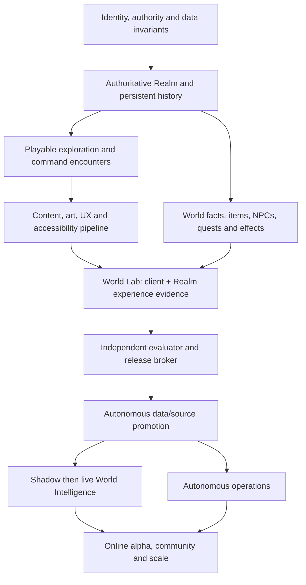

# Complete capability atlas

**Status, 11 October 2026:** this is the structural inventory for the entire Living World experiment. It is deliberately broader than a roadmap. A roadmap chooses what to build next; this atlas records every enduring capability family that must be considered before any component is described as a complete autonomous online RPG.

It does not pretend to list every future creature, spell, map tile, story or technology. Those are unbounded content. Instead, it lists every **decision space** from which such concrete work must derive. Every future feature must be registered against this atlas with a purpose, dependencies, authority, persistence model, evaluation and rollback plan.

## How to use the atlas

Each capability is a value the game or studio may eventually need. Its existence in this document does not mean it should be implemented now. For every chosen item, create a capability record containing:

| Record field | Required answer |
| --- | --- |
| Purpose | Which player/studio outcome does this serve? |
| Contract | What inputs, outputs, saved state and invariants define it? |
| Dependencies | Which prior capabilities, data and tools must exist? |
| Authority | Is it game-runtime, autonomous-studio, owner-control-plane or public-player authority? |
| Abuse/failure | How could it damage player agency, history, identity, security or budget? |
| Evidence | What rule, experience, performance, accessibility, migration and recovery proof is required? |
| Release class | Shadow, reversible data, staged source, canary or constitutional request? |
| Learning loop | What observation would prove or disprove the expected value? |

This applies the MDA distinction between **mechanics, dynamics and player experience**: an implemented rule is not evidence that the intended experience occurred. [MDA framework](https://www.cs.northwestern.edu/~hunicke/MDA.pdf)

### Status vocabulary

- **Foundation:** durable project capability already works and has meaningful evidence.
- **Partial:** a narrow version exists; it does not justify claiming the full family is solved.
- **Planned:** structurally required but no implemented end-to-end capability.
- **Conditional:** only needed if a measured product direction or public scale requires it.

## A. Product identity, experience and design direction

These are the values that prevent a collection of systems from becoming a different game.

| ID | Capability family | Required values |
| --- | --- | --- |
| A1 | Protected player contract | Shared top-down physical world; original fantasy identity; command-driven encounters; ordinary beginnings; behavior-led identity; history; agency; recoverable progress; non-coercive world health. **Foundation in policy; executable validator planned.** |
| A2 | Experience intent | Discovery, wonder, competence, challenge, expression, fellowship, consequence, narrative tension, rest and recovery; explicit anti-goals such as compulsive retention pressure. |
| A3 | Primary-loop design | Arrival → exploration → observation/choice → encounter/problem → consequence/reward → new possibility → return to world; loop duration, variation and exit points. |
| A4 | Design language | Shared vocabulary for risk, rarity, power, cost, friction, mastery, mystery, fairness, clarity, surprise, consent and player-facing explanations. |
| A5 | Change governance | Impact classifier, constitutional fixtures, dominant-loop map, identity ledger, change budget and protected-policy release denial. **Planned.** |
| A6 | Content pillars | Region/faction/creature/quest/item/skill/archetype pillars; what makes each original and useful rather than filler. |
| A7 | Difficulty philosophy | Learnable failure, readable threats, optional mastery, accessibility accommodations, anti-grind stance, recovery after defeat and tuning policy. |
| A8 | Time philosophy | Session-length support, idle/reconnect behaviour, pause/exit safety, seasonal/event cadence, anti-FOMO rules and real-time dependencies. |
| A9 | Player agency policy | Meaningful refusal, alternate solutions, reversible choices, major-identity consent, information asymmetry limits and no unwinnable hidden requirement. |
| A10 | Design knowledge base | Versioned design/art/narrative/technical bibles, decisions, experiments, rejected alternatives and current uncertainty. |

## B. Player embodiment, exploration and interaction

| ID | Capability family | Required values |
| --- | --- | --- |
| B1 | Identity and session | Account/persona, guest-to-account migration, display identity, recovery, privacy, device/session management and safe logout. **Guest foundation only.** |
| B2 | Avatar embodiment | Appearance, movement modes, collision body, facing, animation, emotes, accessibility alternatives and visual identity continuity. |
| B3 | Spatial movement | Walking, collision, pathing, camera, camera comfort, input buffering, prediction/reconciliation, terrain effects, safe spawn and stuck recovery. |
| B4 | Exploration grammar | Landmarks, routes, hidden but discoverable places, map readability, points of interest, environmental storytelling, revisit value and exploration rewards. |
| B5 | World interaction | Inspect, talk, gather, use, activate, place, push, unlock, rest, trade, teach, cooperate and decline; contextual affordance clarity. |
| B6 | Navigation support | Mini/full maps, landmarks, compass, journal, optional route help, quest hints, coordinates, accessibility navigation, undiscovered-space policy. |
| B7 | Environment response | Day/night, weather, season, terrain, hazards, biomes, ambient life, destructible/changeable state and local persistence. |
| B8 | Travel systems | Regions, gates, fast travel, transport, return paths, safe zones, instancing/sharding boundaries and travel failure recovery. |
| B9 | Discovery and knowledge | Personal/shared discoveries, unknowns, lore clues, player notes, rumor/fact separation, map reveal and discovery provenance. |
| B10 | Input and device support | Keyboard/mouse, touch, controller, remapping, hold/toggle choices, vibration, sensitivity, reduced motion and offline input loss behaviour. |

## C. Encounters, combat and tactical play

| ID | Capability family | Required values |
| --- | --- | --- |
| C1 | Encounter entry/exit | Trigger rules, visibility/telegraphing, voluntary/forced distinction, party/nearby-player rules, retreat, reconnect, defeat and world re-entry. **Partial foundation.** |
| C2 | Turn structure | Initiative, turns, phases, timers, target selection, action legality, turn history, latency/reconnect handling and spectator/party behaviour. |
| C3 | Command vocabulary | Attack, defence/guard, skills, items, movement/position where relevant, negotiation/escape and context-specific commands; all readable and meaningful. |
| C4 | Combat resources | Vitality, status effects, cooldowns, charges, mana/stamina equivalents, equipment state, consumables, resistances and recovery. |
| C5 | Tactical dynamics | Trade-offs, telegraphs, risk/reward, counterplay, build diversity, team roles, enemy intent, adaptive but fair behaviour and anti-dominant-strategy tests. |
| C6 | Opponents | Creature/NPC archetypes, behaviors, phases, variants, encounters, bosses, spawn/respawn, ecology, drops, surrender and nonlethal paths. |
| C7 | Rewards and consequences | Experience/progression, materials, items, world change, story state, injury/defeat recovery, loss limits and anti-farm safeguards. |
| C8 | Presentation | Encounter scene, animation, VFX, camera, sound, logs, damage/status readability, combat speed, reduced-flash/reduced-motion modes. |
| C9 | Balance practice | Simulation, encounter matrix, telemetry, player intent tests, versioned balance data, rollbackable tuning and anti-power-creep policy. |
| C10 | Integrity | Server-authoritative commands/results, anti-cheat validation, action rate limits, replay/audit record, deterministic reproduction and exploit response. |

## D. Identity, progression, abilities and social legacy

| ID | Capability family | Required values |
| --- | --- | --- |
| D1 | Ordinary beginning | Starter experience with no mandatory fixed class, understandable possibilities, recovery from poor early choices and anti-overwhelm pacing. |
| D2 | Behavior evidence | Repeated actions, context, difficulty, sacrifice, cooperation/refusal, novelty, history and confidence; evidence retention and privacy bounds. |
| D3 | Recognition | Candidate interpretations, competing explanations, lineage/novelty, player consent, typed effect, player explanation, decline/deferral and duplicate prevention. |
| D4 | Skills and archetypes | Acquisition, practice, costs, prerequisites, combinations, teaching, respec/retirement, version migration, counters and visual representation. |
| D5 | Character development | Attributes, loadouts, equipment, talents, personal goals, reputation, scars/achievements, cosmetic expression and accessible presentation. |
| D6 | Lineage and teaching | Teacher/student relationships, public/private knowledge, inheritance, imitation, lost arts, provenance and abuse/alt-account controls. |
| D7 | Reputation and relationships | Personal/faction/world reputation, trust, promises, grievance, repair, decay, visibility and mistaken-belief separation. |
| D8 | Legacy/history | Chronicle, journals, milestones, rare artifacts, memorials, historical maps, continuity through client/schema migration and right-to-forget policy. |
| D9 | Fairness | Newcomer catch-up, rarity without permanent supremacy, counterplay, anti-snowball design, group power balance and accessibility of meaningful paths. |
| D10 | Evaluation | Does identity feel discovered rather than assigned? Can players understand why? Do paths remain diverse and reversible? Does recognition abstain when evidence is weak? |

## E. Items, resources, crafting and economy

| ID | Capability family | Required values |
| --- | --- | --- |
| E1 | Item ontology | Materials, tools, consumables, equipment, quest items, artifacts, cosmetics, currencies, bound/unbound state, condition and stable IDs. |
| E2 | Ownership/provenance | Creation, pickup, transfer, consumption, destruction, duplication prevention, audit, migration and recovery. **Partial foundation.** |
| E3 | Gathering and production | Nodes, regeneration, skills, recipes, tools, quality, by-products, regional ecology, queueing and accessibility input. |
| E4 | Crafting and modification | Recipes, discovery, experimentation, repair, enhancement, dismantling, visual change, risk/cost, provenance and balance controls. |
| E5 | Trading/gifting | Direct trade, marketplaces, offers, escrow, taxes/fees if used, fraud prevention, price history, player protection and dispute handling. |
| E6 | Currency and sinks | Currency creation/removal, inflation/deflation monitoring, scarcity, sinks, grants, debt policy and anti-exploit limits. |
| E7 | Loot/rewards | Tables, pity/rarity policy, personal/group allocation, duplicate handling, inventory pressure, drop provenance and economy impact evaluation. |
| E8 | Storage and housing | Bank/stash, shared storage, capacity, permissions, loss/recovery, decoration/building if adopted and long-term persistence. |
| E9 | Monetization boundary | Cosmetic/optional purchases only if owner later chooses; no pay-for-power, gambling, dark patterns or AI-controlled payment access. **Owner policy conditional.** |
| E10 | Economy intelligence | Supply/demand observation, anomaly/exploit detection, simulation, intervention proposals, player-impact evaluation and rollback. |

## F. Narrative, NPCs, quests and world simulation

| ID | Capability family | Required values |
| --- | --- | --- |
| F1 | Canonical world facts | Places, eras, entities, relationships, capabilities, events, uncertainty, source/provenance, version and contradiction state. |
| F2 | NPC model | Identity, beliefs distinct from facts, goals, disposition, knowledge scope, relationships, location, schedule, dialogue voice and memory correction. |
| F3 | Dialogue | Authored/generated hybrid, turn context, fact grounding, safety, player choices, tone, accessibility, localization, logging and fallback. |
| F4 | Quest structure | Goals, prerequisites, alternatives, rewards, refusal, expiry, sharing, concurrency, failure/repair, migration and clear player framing. |
| F5 | Commitment ledger | Promise, owner, state, deadline/expiry, supporting facts, allowed resolutions, player-visible wording and adversarial tests. **Planned.** |
| F6 | World events | Ecology, factions, weather, settlements, crises, discoveries, calendar, player influence, reversibility, pacing and regional diversity. |
| F7 | Causality | What changed, why, by whom, what evidence supports it, which systems/NPCs know it and how it is replayed/rolled back. |
| F8 | World Intelligence | Retrieval, evidence coverage, uncertainty/abstention, structured proposal, typed effect, budget, consent, validator, receipt and post-effect observation. **No live inference.** |
| F9 | Lore and mystery | Canon, ambiguity, discoverable clues, contradictory rumors, secret handling, reveal pacing, player interpretation and continuity checks. |
| F10 | Narrative evaluation | Contradiction, dead end, false promise, forced outcome, repetition, cultural sensitivity, player agency, novelty and long-arc coherence tests. |

## G. Multiplayer, community and player trust

| ID | Capability family | Required values |
| --- | --- | --- |
| G1 | Presence | Concurrent visibility, join/leave, privacy modes, proximity, parties, groups, instancing/shards and reconnect rules. **Basic presence foundation.** |
| G2 | Cooperation | Party formation, roles, shared objectives, revive/help, shared rewards, teaching, trading, consent and abuse prevention. |
| G3 | Communication | Text, emotes, voice if adopted, channels, language/localization, rate limits, block/mute, reporting, history and accessibility alternatives. |
| G4 | Social structures | Friends, guilds/factions, permissions, shared spaces, leadership succession, membership safety, governance and archival. |
| G5 | Player-created expression | Names, profiles, cosmetics, housing/building, notes, art/text if adopted, ownership, attribution, moderation and export. |
| G6 | Moderation | Rules, detection, reports, review queues, action ladder, appeals, evidence retention, transparency and emergency controls. |
| G7 | Safety/privacy | Age approach, consent, data minimization, account protection, harassment prevention, sensitive-content handling and support access. |
| G8 | Fair play | Bot/cheat detection, multibox/alt policy, exploit reporting, sanctions, false-positive correction and competitive integrity if relevant. |
| G9 | Support and communication | Help center, known-issue status, in-game notices, maintenance notices, player feedback, bug reports and compensation policy. |
| G10 | Community evaluation | Belonging, safety, conflict, collaboration, retention without coercion, newcomer experience and moderator workload. |

## H. Visual art, audio, interface and accessibility

| ID | Capability family | Required values |
| --- | --- | --- |
| H1 | Art direction | Palette, lighting, silhouette, scale, composition, biome language, architecture, creature language, UI language and evolution rules. |
| H2 | Asset lifecycle | Brief, concept alternatives, provenance/license, source, import, variants, stable entity binding, hashes, dependencies, release and rollback. |
| H3 | Animation/VFX | Movement, idle, action, impact, weather, particles, telegraphs, camera, reduced motion/flash and performance budgets. |
| H4 | Map/environment art | Tiles, layers, seams, collision alignment, landmarks, occlusion, parallax, lighting, weather, destructible/state variants and streaming. |
| H5 | Character/creature presentation | Shape language, readable states, equipment/identity variation, portraits, emotes, encounter representation and animation quality. |
| H6 | Interface | HUD, menus, journal, inventory, map, encounters, onboarding, errors, loading, settings, notifications, hierarchy and controller/touch parity. |
| H7 | Audio | Music direction, ambience, effects, dialogue strategy, adaptive mix, volume groups, captions, visual/audio alternatives, licensing and latency. |
| H8 | Accessibility | Remapping, text size, contrast, color alternatives, captions, readable saves, input alternatives, difficulty aids, screen-reader/assistive support and motion controls. [Game Accessibility Guidelines](https://gameaccessibilityguidelines.com/full-list/) |
| H9 | Performance/fidelity tiers | Browser compatibility, native high fidelity, resolution/scaling, texture/download budgets, frame targets, battery/thermal impact and fallbacks. |
| H10 | Creative evaluation | In-game scene capture, contact sheets, visual regression, legibility, originality, coherence, diversity, performance, player preference and portfolio evolution. |

## I. Client, Realm, data and online platform

| ID | Capability family | Required values |
| --- | --- | --- |
| I1 | Client architecture | Browser and downloadable clients, versioned protocol, local cache, render/input separation, prediction/reconciliation, crash reporting and auto-update policy. |
| I2 | Realm authority | Validated intents, authoritative simulation, state deltas, action receipts, protocol errors, rate limits, anti-cheat and deterministic replay. **Foundation, narrow scope.** |
| I3 | Persistent storage | Schema, migrations, indexes, retention, backups, restore, encryption boundaries, history replay, archive and scale adapters. **SQLite foundation.** |
| I4 | Protocol and compatibility | Schema versions, negotiated capabilities, old-client policy, disconnect/retry, idempotency, correlation IDs, load shedding and graceful degradation. |
| I5 | Accounts/identity | Registration, authentication, verification, recovery, MFA if appropriate, session/device lifecycle, roles, consent and deletion/export. **Planned for public launch.** |
| I6 | Edge/network | HTTPS/WSS, TLS, proxy/origin policy, DDoS/rate controls, connection caps, headers, certificates, regional routing and incident isolation. |
| I7 | Distribution | Immutable web/native artifacts, manifest, signing, CDN/object store, staged channels, patch/update, rollback and download integrity. |
| I8 | Scale/resilience | Declared capacity, connection/session strategy, database scaling path, cache/queue use only when measured, regional recovery and failure domains. |
| I9 | Security | Threat model, secrets, dependency provenance, vulnerability response, input validation, authorization, audit log, abuse testing and incident response. WebSocket messages need explicit origin/authentication/validation/rate-limit handling. [OWASP WebSocket security](https://cheatsheetseries.owasp.org/cheatsheets/WebSocket_Security_Cheat_Sheet.html) |
| I10 | Platform evaluation | Load/soak, latency, frame/network budget, crash-free sessions, account isolation, backup restore, disaster recovery and compatibility tests. |

## J. Autonomous intelligence, tools and learning

| ID | Capability family | Required values |
| --- | --- | --- |
| J1 | Work selection | Evidence intake, backlog, prioritization, reversibility/cost/impact estimate, dependency planning, quiet-cycle rule and duplicate prevention. |
| J2 | Durable orchestration | Jobs, leases, checkpoints, retries, cancellation, circuit breakers, scheduling, interruption recovery and truthful state. **Partial foundation.** |
| J3 | Studio workspaces | Repository map, manifests, pinned toolchains, sandbox lifecycle, mounts, snapshots, artifact export and task-scoped capabilities. |
| J4 | Creative intelligence | Design/art/narrative bibles, alternatives, portfolios, generation adapters, asset/content manifests, scene review and originality safeguards. |
| J5 | Developer intelligence | Code understanding, implementation, dependency management, migrations, tests, build/export, documentation, remediation and outcome memory. **Isolated-copy foundation.** |
| J6 | World intelligence | Fact retrieval, semantic/structured memory, proposal schemas, abstention, effect vocabulary, cost/latency management and player-agency controls. |
| J7 | Evaluation intelligence | Trace capture, tests, graders, held-out cases, regression generation, experiment analysis, calibration and evidence quality. |
| J8 | Operator intelligence | Metrics/alerts, diagnosis, runbooks, health/capacity/cost actions, incident records, recovery verification and escalation. |
| J9 | Learning integrity | Raw fact preservation, hypothesis/outcome ledger, confidence, causal caution, no self-certified truth, no silent model-weight-training claim and anti-churn rules. |
| J10 | Agent safety | Structured inputs/outputs, untrusted-text handling, narrow tools, scoped grants, secret brokers, network isolation, policy broker, audit, independent release validation and fail-closed behavior. [OpenAI agent safety](https://developers.openai.com/api/docs/guides/agent-builder-safety) |

## K. Verification, release and operations

| ID | Capability family | Required values |
| --- | --- | --- |
| K1 | Test portfolio | Unit, property/model, integration, schema/migration, replay, fuzz, load, browser/native, visual, accessibility, security and recovery tests. |
| K2 | Test actors | Contract player, explorer, intent player, hostile-input actor, load actor, long-history actor and accessibility actor. |
| K3 | World Lab | Disposable candidate Realm/client, sanitised fixtures, build/import/export, controlled faults, captured experience and one-way evidence channel. **Planned.** |
| K4 | Artifact/provenance | Source/dependency/content/asset hashes, build environment, SBOM, signatures, policy version, test report, release intent and retention. |
| K5 | Policy and constitutional validation | Protected fixtures, release-band checks, capability grants, budget reservation, independent evaluator, blocked-change record and owner-only policy revisions. |
| K6 | Deployment | Immutable promotion, environment config, migration transaction, backup-before-change, canary, observation window, progressive rollout, rollback and release communication. |
| K7 | Observability | Health, logs, traces, errors, latency, frame time, queue depth, database state, player experience, integrity, cost and release correlation. |
| K8 | Reliability | SLOs/SLIs, error budgets, alert thresholds, overload/load shedding, process supervision, maintenance windows, incident command and postmortems. [Google SRE workbook](https://sre.google/workbook/table-of-contents/) |
| K9 | Continuity | Backups, verified restore, point-in-time/replay needs, off-host copies, disaster scenarios, provider outage, bad release, credential loss and data-corruption drills. |
| K10 | Cost/resource control | Model/asset/compute/storage/bandwidth cost, quota/reservation/settlement, anomaly detection, degradation, capacity forecasts and owner reports. |

## L. Owner Lab, public obligations and external boundaries

| ID | Capability family | Required values |
| --- | --- | --- |
| L1 | Owner control plane | Constitution, operating policy, release bands, payment/budget/provider, credentials/network/hosting/signing, emergency pause/revoke/restore and audit export. |
| L2 | Admin visibility | World health, cost, active grants, candidate/release results, identity ledger, portfolio, incidents, backup freshness and policy history; no unrestricted shell/SQL. |
| L3 | Legal/rights | Asset license/provenance, generated-content disclosures where required, privacy/data rights, terms/community policy, copyright/takedown path and jurisdiction review. |
| L4 | Payment boundary | Owner-controlled payment provider and pricing configuration; no AI access to payment credentials, refund/payment execution or autonomous financial policy. |
| L5 | Player data rights | Consent, collection minimization, export/delete/correction where applicable, retention schedule, access controls and breach response. |
| L6 | Transparency | Status, known limitations, AI-generated-content policy, release notes, moderation actions, service incidents, appeals and player-facing explanations. |
| L7 | External integrations | Provider registry, purpose/scope, data flow, credential broker, allowlist, rate/cost cap, failure mode, revocation and audit. |
| L8 | Public launch gates | Security review, account recovery, moderation readiness, load/restore evidence, accessibility baseline, age/privacy obligations, support path and incident process. |
| L9 | Sunset/portability | Exportable player/world records, engine/client/server migration plan, data archive, dependency replacement, owner access recovery and service shutdown policy. |
| L10 | Governance evaluation | Is the owner still only controlling external values? Can the AI perform ordinary work without hidden human labour? Is every override logged and reviewable? |

## Cross-cutting values that apply to every capability

Every row above must be evaluated against all of these, even when it is “only” a visual asset or a small code change:

1. **Originality and rights:** no copied IP, unlicensed asset or unverifiable generated source.
2. **Player agency:** choice, consent, understandable consequence and safe exit.
3. **Persistence:** versioning, migration, history/provenance and recovery.
4. **Accessibility:** perceptibility, operability, understandability and accommodation.
5. **Security and privacy:** untrusted input, least privilege, data minimization and audit.
6. **Performance and cost:** measurable budgets and degradation rather than surprise failure.
7. **Multiplayer fairness:** server authority, anti-exploit behavior and newcomer viability.
8. **Observability:** every consequential action can be detected, explained and reproduced.
9. **Reversibility:** content, code, schema and operational changes have a defined recovery path.
10. **Autonomous integrity:** the AI cannot grant itself authority, mark its own work safe, erase unfavorable evidence or alter the protected validator.

## Capability dependencies: what must exist before what

The atlas is intentionally comprehensive, but implementation must respect dependency order:

This means, for example, that procedural lore is not valuable before canonical facts and commitment tests; an autonomous artist is not proven before it can render and evaluate scenes; downloadable clients are not a public platform before account/security/distribution/recovery gates; and self-selected coding is not autonomous operation before the World Lab and independent release broker exist.

## Current baseline against the atlas

| Area | Honest current condition |
| --- | --- |
| Protected identity and owner Lab | Strong written foundation; executive enforcement/identity fixtures still planned. |
| Authoritative local RPG | Working small browser/Node/SQLite seed with movement, gathering, history, separate command encounters, one quest, persistence and backups. |
| Autonomous developer | Isolated source-copy Codex work, durable records, outcome memory and constrained visual-data publication; no general source release. |
| Godot client path | Pinned local toolchain and a fixture-only shell; no Realm protocol parity yet. |
| World Intelligence | Data/history substrate and deterministic work exist; provider/model inference and live Recognition/quest effects remain disabled/unbuilt. |
| Creative studio | A small code-drawn visual system and limited validated data lane; no complete asset/audio/portfolio pipeline. |
| World Lab/release/operator | Designed in detail but not implemented as a disposable candidate Realm, independent evaluator or unattended production operator. |
| Public online world | Not ready: accounts, hosted edge, moderation, legal/privacy, security hardening, capacity, off-host recovery and launch evidence remain future work. |

## Rule before declaring any milestone complete

No milestone is complete because a feature exists. It is complete only when the selected capability record has evidence for its contract, experience, safety, persistence, accessibility, cost, operation and rollback requirements—and when its dependencies remain healthy.

The atlas should be updated whenever a new category is discovered. The autonomous studio may add ordinary capability records and proposals. It cannot remove a protected category, weaken cross-cutting values or reclassify an owner-controlled boundary as its own authority.
