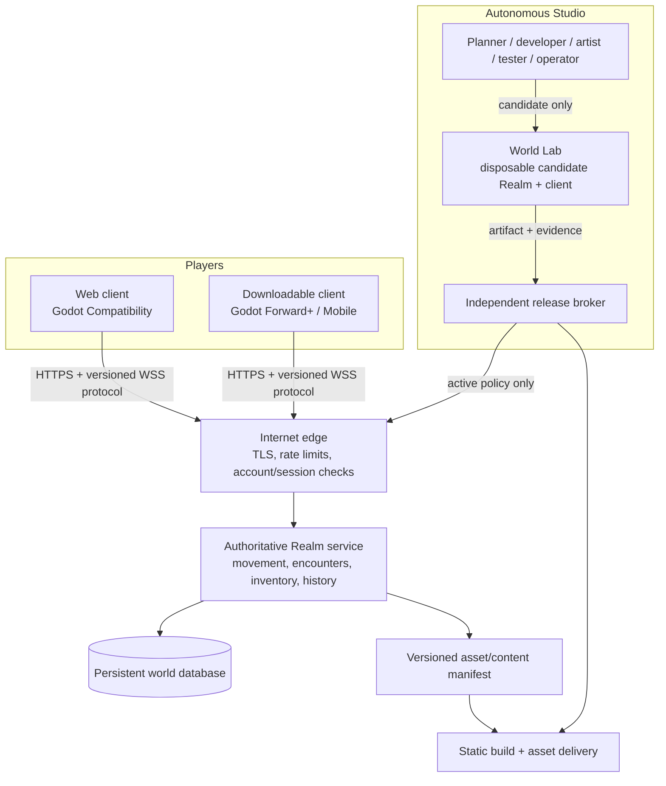

# Online runtime platform decision

**Decision date: 11 October 2026.** Living World should grow into an online service with a browser client and downloadable desktop clients, while an autonomous studio owns ordinary development, content, art, testing, releases and operation. This document selects the technical direction without changing the current runtime yet.

## Decision

Adopt **Godot 4.x with GDScript for a new player-client project**, while retaining the existing Node authoritative-world service as the source of truth during the first migration. Ship the same Godot client project to:

- a browser build using the Compatibility renderer;
- native Windows, Linux and macOS builds, initially Windows first;
- a future native “high-fidelity” desktop mode using Forward+ where the hardware supports it.

Do **not** make the client engine responsible for permanent world state, combat outcomes, player inventories, quests, identity or World Intelligence effects. Those stay in an authoritative online Realm service. Do **not** ask an admin to operate a game editor, run builds, copy files, upload assets, or decide routine changes. The autonomous studio performs those actions through reproducible command-line tools and release policy; the Lab only grants external authority and shows evidence.

This preserves the Constitution's persistent top-down browser RPG while allowing the renderer, art direction, interaction, maps and client architecture to evolve radically.

## Why Godot over Unity for this experiment

Unity can build dedicated servers and desktop clients, and is capable of excellent graphics. It is a valid later alternative. It is not the best first platform for Living World's current shape: an AI-operated, open, top-down online RPG that must produce both browser and downloadable clients without an administrator doing editor work.

| Requirement | Godot 4 + GDScript | Unity | Living World conclusion |
| --- | --- | --- | --- |
| Autonomous editing | Project scenes, scripts, resources and import rules are repository files; builds, tests and headless runs work from a command line | C# is strong, but substantial workflows commonly center on the Unity Editor and metadata-heavy assets | Godot is easier to make reproducible, inspectable and agent-operated from the start. |
| Browser + native client | Web export and native export from one project; browser uses WebGL 2 Compatibility | Web and native targets are available | Both are viable; Godot has the simpler initial fully textual workflow. |
| “Sexy” desktop visuals | Forward+ provides advanced desktop rendering; 2D can use lighting, shaders, particles, animation, post-processing and 2.5D depth | Excellent high-end rendering and tooling | Visual quality depends primarily on art direction, assets, performance budgets and evaluation. Godot meets the intended 2D/2.5D fantasy target. |
| Web constraints | Same game can export to web, but WebGL 2 Compatibility has a defined lower feature ceiling | Web builds also have browser constraints | Treat web as the accessible baseline; native desktop is the high-fidelity target. |
| Dedicated/headless execution | Supports `--headless` and dedicated-server exports | Supports dedicated-server build targets | Keep the persistent Realm independently authoritative rather than coupling it to either engine. |
| Long-lived autonomy | Open source engine and text-first project reduce license and GUI-automation dependency | Mature ecosystem, but a larger editor-centred workflow and vendor policy are additional operating variables | Start Godot; keep protocol/content boundaries portable so a later engine replacement remains possible. |

Godot’s documentation confirms the relevant platform facts: headless and dedicated-server exports are supported, a web export targets WebAssembly/WebGL 2, and native Forward+ offers substantially richer desktop features than the web-compatible renderer. [Dedicated servers](https://docs.godotengine.org/en/stable/tutorials/export/exporting_for_dedicated_servers.html) [Web export](https://docs.godotengine.org/en/4.5/tutorials/export/exporting_for_web.html) [Renderer comparison](https://docs.godotengine.org/en/stable/tutorials/rendering/renderers.html)

This is a platform choice, not an engine religion. The autonomy contract requires the client to be replaceable. If future player evidence shows that Godot cannot meet a concrete visual, console, multiplayer or tooling requirement, the studio can propose a migration with compatibility evidence. It cannot silently replace the top-down persistent RPG or discard player history.

## The target architecture

### The Realm service remains authoritative

The current Node service already validates WebSocket actions and owns state. Preserve that principle through the migration:

- Clients send **intent**, never authoritative position, damage, reward, inventory or quest completion.
- The Realm validates the intent against its current state, writes its event/history record and publishes a versioned state delta.
- The client predicts only presentation where needed and reconciles to the Realm response.
- Every action and state message uses a versioned schema, correlation ID, idempotency key where it can have a durable effect, and a clear compatibility strategy.

Godot’s own multiplayer documentation makes the same security point: high-level networking does not make a persistent game secure; gameplay-critical state should remain server authoritative and all client arguments require validation. [Godot secure multiplayer design](https://docs.godotengine.org/en/latest/tutorials/networking/high_level_multiplayer.html#secure-multiplayer-design)

For the initial migration, use a custom versioned WebSocket protocol over WSS because it matches the current browser service and is supported by Godot web clients. Do not build a second authoritative multiplayer system inside the Godot client. Native-only UDP/ENet optimization is a later measured decision; it would otherwise split browser and desktop networking prematurely.

## Player experience and graphics model

The intended game remains a readable 2D top-down RPG. “Better graphics” means a coherent visual language and richer presentation, not abandoning the world for generic 3D spectacle.

| Layer | Web baseline | Native high-fidelity client | Autonomy requirement |
| --- | --- | --- | --- |
| World | Tile/map layers, animated sprites, particles, camera movement, lighting that works on Compatibility | Richer lighting, shadows, shaders, particles, weather, depth, post-processing and optional 2.5D scenes | Each content pack declares its fallback and render budget. |
| Encounters | Clear command screen, readable effects, accessible motion/contrast choices | Animated attacks, depth, camera work, richer VFX/audio and configurable quality | Command choices and server outcomes remain identical. |
| Characters and creatures | Original sprites/animations and silhouettes | Higher-resolution animated portraits, effects, optional skeletal/3D elements | Asset lineage, licenses/origin and style-bible version are recorded. |
| Sound | Player-initiated audio enablement, simple compatible playback | Spatial mix, richer effects and quality settings | Audio is optional, has volume controls and never blocks play. |
| Performance | Fixed frame-time, memory and download budgets; Compatibility renderer | Quality tiers and adaptive settings | Lab captures real frame time and GPU/CPU evidence on reference machines. |

Godot web builds currently use WebGL 2 and the Compatibility renderer; Forward+/Mobile rendering are not available on web. This is why the web build must be designed as a deliberate quality tier, while the downloadable client is where the studio can deploy the richer visual stack. [Godot web limitations](https://docs.godotengine.org/en/4.5/tutorials/export/exporting_for_web.html) [Renderer comparison](https://docs.godotengine.org/en/stable/tutorials/rendering/renderers.html)

The art system needs two independent versioned products:

1. **Art bible:** style intent, palette/lighting rules, scale, silhouette language, animation cadence, UI language, sound direction, accessibility and performance budgets. The autonomous studio may evolve it through versioned releases and comparison evidence.
2. **Asset manifest:** each source asset, generated derivative, import setting, license/provenance, content hash, target platform variants, dependencies and rollback version. The engine imports from this manifest; it never relies on an untracked desktop editor state.

## The environment where the AI works

The AI needs a real production-like environment, but it must be a **World Lab**, not the live host. It is made of reproducible layers:

| Layer | What the AI receives | What it cannot receive | Evidence it must return |
| --- | --- | --- | --- |
| Source workspace | Pinned Node, Godot editor/export templates, project files, tests, tool wrappers and sanitised fixtures | Production database, signing key, cloud credentials, owner session, unrestricted host folders | Candidate source hash, diff and declared capability request. |
| Build cell | Command-only imports, lint/tests, Godot headless checks, native/web export, asset validation and dependency lockfiles | Production network, release authority and mutable trusted policy | Reproducible artifacts, build log, SBOM/dependency manifest. |
| Candidate Realm | Disposable Realm service, synthetic or scrubbed world fixture, local WSS endpoint and controlled fault injection | Live sessions, secrets, ability to reach production or mutate backups | Migration, replay, load, recovery and protocol evidence. |
| Client test cell | Browser plus native Godot build, scripted contract/explorer/intent playthroughs, screenshots/recordings and performance capture | Owner desktop and unbounded internet | Experience report, accessibility checks, visual regressions and known failures. |
| Release broker | A narrow request interface for approved artifacts | Ability for the candidate to rewrite release policy, sign arbitrary content or deploy itself | Independent validation record, backup/rollback receipt and promotion decision. |

The studio can create and change normal code, scenes, assets, tests and build scripts. It must work through tools such as `godot --headless --editor --import`, headless project tests, exports and packaged screenshot/playthrough runners—not by an administrator clicking an editor. The Godot command line and dedicated-server/headless mode make that workflow feasible. [Godot command line](https://docs.godotengine.org/en/stable/tutorials/editor/command_line_tutorial.html) [Dedicated-server/headless mode](https://docs.godotengine.org/en/stable/tutorials/export/exporting_for_dedicated_servers.html)

No generated candidate runs on the privileged Windows host, and no candidate gets an open-ended shell or cloud token. Its actions are narrow tool calls; the trusted broker validates each request independently. This preserves the boundary required by the autonomy audit and current agent-security guidance. [OWASP: Excessive Agency](https://genai.owasp.org/llmrisk/llm062025-excessive-agency/) [OpenAI sandbox security](https://developers.openai.com/api/docs/guides/agents/sandboxes#security)

## Hosting path: local lab to public online world

### Local production-like development

Keep the current localhost Realm working while introducing isolated environments. The first target is a local multi-process stack, not a public cloud deployment:

- one Realm instance with a dedicated fixture database;
- one Godot client project, exportable to web and native Windows;
- one static build server/edge emulator for browser builds;
- a separate Lab controller and release broker;
- a repeatable one-command start, stop, destroy and recreate workflow.

The AI operates this stack. The owner opens the Lab only to observe and set the authority envelope.

### Invite-only online alpha

Before exposing a public URL, promote only a proven build to a small Linux-hosted stack:

- TLS-terminating edge with WebSocket support, origin checks, request/action rate limits and structured access logs;
- one authoritative Realm process with a declared concurrency ceiling;
- a proper account/session system, recovery, abuse controls and owner role separation;
- managed or self-operated PostgreSQL with tested backups/restores before abandoning the current single SQLite volume for public concurrent operation;
- static native/web build distribution from immutable versioned artifacts; build signing through a brokered signing service;
- metrics, logs, traces, alerts, capacity measurement, canary release and audited rollback.

Do not add shards, Redis, Kubernetes, matchmaking or multiple database writers until measured player load requires them. A single well-observed Realm is the right first online alpha; the protocol and storage adapters must make later scaling possible.

### Downloadable clients

Start with signed Windows artifacts, then add Linux/macOS once Lab evidence covers them. The release broker creates a manifest with build hash, protocol version, minimum server version, asset bundle hashes, update URL and rollback channel. A future auto-updater is another privileged distribution tool; it should only accept broker-signed manifests and retain a prior working client for rollback.

The owner never manually packages or uploads a release. The studio produces the artifact and evidence; the broker publishes only if the currently selected release band allows it.

## Migration plan that protects the live game

| Slice | Deliverable | Saved-world protection | Autonomous proof |
| --- | --- | --- | --- |
| 0 — Contract extraction | Versioned schemas for welcome/state/action/error messages and asset/content IDs; fixture capture from the current Realm | Existing browser client continues unchanged | Agent proves old and new protocol fixtures round-trip. |
| 1 — Godot shell | New Godot repository folder, GDScript client shell, connection/reconnect, map/camera/input and a read-only state visualiser | No gameplay write path from Godot yet | Headless import/export plus browser/native screenshots. |
| 2 — Authoritative play | Godot sends existing intents; Realm validates; client renders encounters/inventory/history | Same Node rules and SQLite history remain authoritative | Contract, explorer and intent playthrough parity against the browser client. |
| 3 — Presentation evolution | Godot maps, effects, UI, audio, animation and native quality tiers | Asset identifiers versioned; simulation remains unchanged | Scene/performance/accessibility evidence and rollbackable asset bundle. |
| 4 — Lab and release broker | Disposable candidate Realm/client stack; independent evaluator; staged artifact promotion | Restored representative world fixture on every migration | Forced broken migration, bad client and service failure each prove rollback/recovery. |
| 5 — Online alpha | Account system, TLS edge, database move when justified, monitoring and invite-only launch | Rehearsed backup restore and server redeploy | Declared-load test, incident drill and immutable release provenance. |

The existing browser canvas client remains the stable local experience until Slice 2 reaches functional parity. There is no destructive rewrite and no break in player history merely to introduce an engine.

## Acceptance gates before engine authority expands

The new engine may replace presentation when it passes these gates; it may never acquire gameplay authority merely because it renders well:

1. **Protocol gate:** message schemas are versioned, fuzzed and compatible with existing sessions; invalid clients cannot create state.
2. **Parity gate:** scripted journeys produce the same Realm outcomes from browser and Godot clients.
3. **Visual gate:** actual screenshots/recordings show readable movement, encounter choices, dialogue, error/reconnect and accessibility states at every supported quality tier.
4. **Performance gate:** defined reference machines meet frame-time, memory, cold-start and download budgets; the browser tier remains playable.
5. **Persistence gate:** client updates, disconnects and failed migrations preserve character location, inventory, encounter and quest history.
6. **Security gate:** a client cannot claim state, access another player's data, replay a durable action or reach operator/admin APIs.
7. **Distribution gate:** only an artifact checked in the Lab can be signed/published; rollback installs the prior artifact and matches its asset manifest.

## What this deliberately does not solve yet

This decision does not authorize paid cloud hosting, select a provider, activate model calls, transfer any credential, or start an engine rewrite. It establishes the destination and the build order. The current Node/browser game remains the operational local world while the first concrete implementation is the World Lab and protocol extraction.

The first build task after the Lab foundation is a **non-destructive Godot client shell** connected to a fixture Realm. That lets the autonomous studio learn to import, export, render, screenshot, test and evolve a real engine project without risking the working world.
